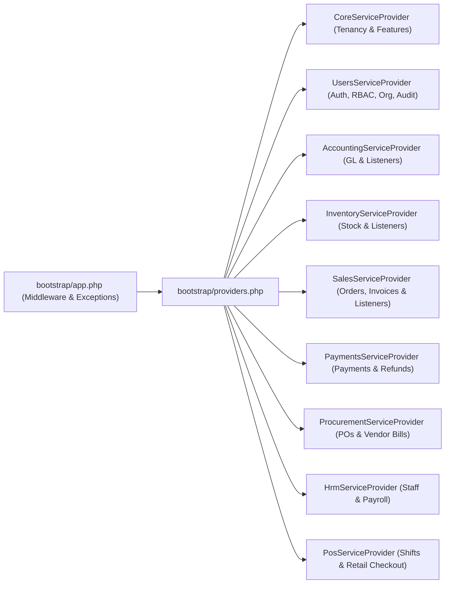
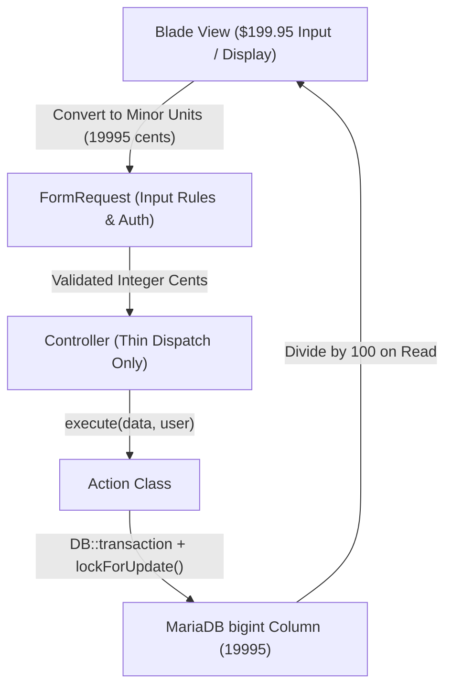

# Phase 1: Foundation & Static Modular Monolith Architecture

## 1. How This Benefits Your Business (Owner's Perspective)

Before writing a single business screen (like Sales or Payroll), an ERP needs rock-solid financial and operational guardrails. Phase 1 establishes four foundational business protections:

1. **Zero Penny Rounding Bugs (Money in `bigint` Minor Units)**:
   Computers lose precision on decimal floats (`0.1 + 0.2 = 0.30000000000000004`). Every dollar figure in this ERP—prices, salaries, taxes, journal debits/credits, cash drawer floats—is stored in the database as an exact whole-number integer in **cents** (e.g., `$199.95` is stored as `19995`), and divided by `100` only when displayed on screen or printed on a receipt.
2. **Department Isolation Without Microservice Overhead (Static Modular Monolith)**:
   Instead of splitting Accounting, Inventory, Sales, HRM, and POS into 9 separate servers that can go out of sync, all 9 modules live cleanly inside `modules/<Domain>/` in one deployable application. Each department owns its own tables, rules, and validations, yet shares ACID database transactions.
3. **Globally Unique, Chronological IDs (`HasUlids`)**:
   Every record uses a 26-character ULID (`01J...`) primary key instead of guessable sequential IDs (`1, 2, 3`). Competitors cannot guess how many invoices or customers you have from URLs like `/invoices/5`, and records still sort chronologically.
4. **Strict Code Contracts**:
   Every PHP file enforces `declare(strict_types=1);` and passes **Laravel Pint** formatting and **Larastan Level 8** static analysis rules.

---

## 2. Architecture & Data Flow Diagrams

### Static Modular Monolith Boot Pipeline
Unlike fragile plugin systems that scan folders dynamically at runtime, Laravel loads all 9 domain Service Providers explicitly from `bootstrap/providers.php`:

### Money Handling & Action Execution Pattern
Every write operation in the ERP follows a strict **Thin Controller -> FormRequest -> Single-Purpose Action** pattern:

---

## 3. How the Code Is Connected End-to-End

| Component | Exact Path / Symbol | Role in the System |
| :--- | :--- | :--- |
| PSR-4 Namespace | `composer.json` (`"Modules\\": "modules/"`) | Maps `Modules\Pos\...` cleanly to `modules/Pos/...` |
| Provider Registry | `bootstrap/providers.php` | Explicitly boots `AppServiceProvider` plus all 9 `Modules\*\Providers\*ServiceProvider` classes |
| Global Middleware & Routing | `bootstrap/app.php` | Aliases `'tenant'`, `'tenant.active'`, `'feature'`, enables session cookies on internal `/api/v1/*` routes, sets `redirectGuestsTo(admin.login)` |
| Web Entry Redirect | `routes/web.php` | Redirects `/` straight to `route('admin.dashboard')` |
| Static Analysis & Style | `pint.json`, `phpstan.neon` | Enforces strict typing and uniform code style across all modules |

### Standard Internal Folder Layout of Every Module
Every business domain under `modules/<Domain>/` follows the identical layout:
- `Providers/<Domain>ServiceProvider.php`: Loads `routes/web.php`, `routes/api.php`, `Database/Migrations/`, and registers cross-module `Event::listen(...)` hooks.
- `Database/Migrations/`: **1 migration file = 1 database table** (strict chronological numbering `000001` through `000041`).
- `Models/`: Eloquent models using `HasUlids`, `BelongsToTenant`, and `Auditable`.
- `Http/Requests/`: Dedicated Form Requests validating rules and bounds before entering business logic.
- `Actions/`: Plain PHP classes with an `execute(...)` method encapsulating `DB::transaction`, locking, business invariants, and `event(...)` dispatching.
- `Http/Controllers/`: Thin HTTP controllers directly inside `Http/Controllers/` (never nested in `Web/`), serving Blade views, Server-Side DataTables JSON, and AJAX endpoints.
- `Events/` & `Listeners/`: Cross-module bridges so departments never directly mutate another department's tables without business logic checks.
