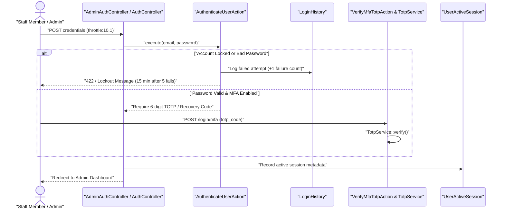
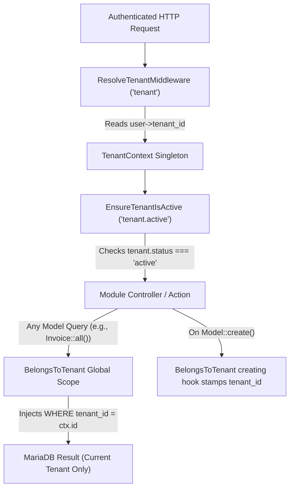

# Phase 2: Multi-Tenancy, Authentication, MFA & Session Control

## 1. How This Benefits Your Business (Owner's Perspective)

If you operate multiple companies, sister brands, or franchises on one ERP server—or plan to offer this platform as SaaS to clients—**data isolation and account security** are non-negotiable:

1. **Bulletproof Tenant Separation**:
   Company A's invoices, bank balances, employee salaries, and stock levels can **never** leak to Company B, even if a programmer forgets to write a `WHERE tenant_id = ...` clause. Every query is scoped automatically by Laravel.
2. **Brute-Force & Account Takeover Prevention**:
   - **Lockout Policy**: `AuthenticateUserAction` tracks failed attempts and locks the account for **15 minutes after 5 failed logins**, logging every attempt into `login_histories`.
   - **Password Reuse Prevention**: `ChangePasswordAction` stores hashed previous passwords in `password_histories` and blocks reusing any of the **last 5 passwords**.
3. **2-Factor Authentication (TOTP MFA)**:
   Staff can link Google Authenticator / Authy (`TotpService` RFC 6238) and receive single-use recovery codes (`user_mfa_secrets`).
4. **Live Session Visibility & Remote Sign-Out**:
   Employees or admins can view every active browser/device session (`user_active_sessions`) and revoke suspicious sessions immediately (`RevokeSessionAction`).

---

## 2. Security & Tenant Resolution Diagrams

### Login, MFA & Session Pipeline

### Automatic Tenant Scoping (`BelongsToTenant` + `ResolveTenantMiddleware`)

---

## 3. How the Code Is Connected End-to-End

### Database Tables (`modules/Core/` & `modules/Users/`)
- `tenants` (`2024_01_01_000001_create_tenants_table.php`)
- `users` extended (`2024_01_01_000002_add_tenant_and_profile_to_users_table.php`)
- `user_mfa_secrets` (`2024_01_01_000003_create_mfa_tables.php`)
- `login_histories` (`2024_01_01_000004_create_login_histories_table.php`)
- `password_histories` (`2024_01_01_000005_create_password_histories_table.php`)
- `user_active_sessions` (`2024_01_01_000006_create_user_sessions_table.php`)

### Key Classes & Wiring
- **`modules/Core/Services/TenantContext.php`**: Request-scoped singleton holding the active tenant (`setTenant()`, `id()`, `requireId()`). Calling `requireId()` fails fast if any action runs without a tenant context.
- **`modules/Core/Traits/BelongsToTenant.php`**: Applied to every tenant-owned model (`Account`, `Product`, `Invoice`, `Employee`, `PosSale`, etc.). Automatically adds a `tenant` global scope on all `SELECT` queries and populates `tenant_id` on `creating`.
- **`modules/Core/Http/Middleware/ResolveTenantMiddleware.php` (`tenant`) & `EnsureTenantIsActive.php` (`tenant.active`)**: Registered as aliases in `bootstrap/app.php`. If a session expires on a web route, `bootstrap/app.php` routes guests back to `route('admin.login')`.
- **`modules/Users/Services/TotpService.php`** & **MFA Actions** (`EnableMfaAction`, `ConfirmMfaSetupAction`, `VerifyMfaTotpAction`): Generate QR provisioning URIs, verify 6-digit time-based codes, and manage recovery codes.
- **`modules/Users/Http/Controllers/`**: `AdminAuthController`, `AuthController`, `MfaController`, `ProfileController`, `SessionController`.
- **Blade UI**: `resources/views/admin/auth/login.blade.php`, `resources/views/admin/profile/profile.blade.php`, `resources/views/admin/profile/change_password.blade.php`.
- **Seeder**: `Modules\Core\Database\Seeders\CoreDatabaseSeeder` seeds the default tenant and initial feature set.
