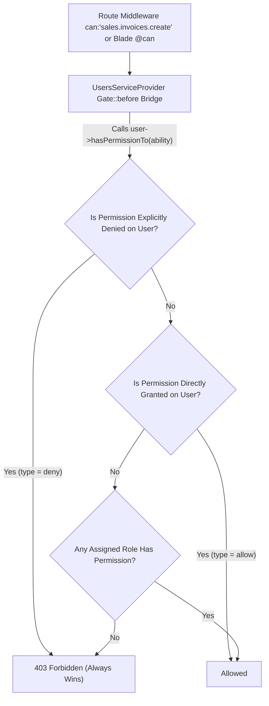
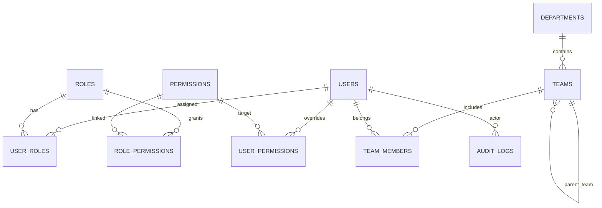

# Phase 3: RBAC, Organization Hierarchy & Immutable Audit Trail

## 1. How This Benefits Your Business (Owner's Perspective)

As a company grows beyond the founder, you cannot give every employee access to payroll, bank accounts, or inventory write-offs—and you need an unforgeable paper trail when numbers change:

1. **Role-Based Access Control (RBAC) with Per-User Overrides**:
   - You assign standard **Roles** (`Super Admin`, `Accountant`, `Sales Manager`, etc.) to staff.
   - If a specific clerk needs one extra screen—or needs to be explicitly blocked from deleting invoices—you can attach a **direct grant or explicit deny** on that user without creating a whole new role.
   - Sidebar menus automatically hide sections a user is not allowed to see (`@can(...)`), while backend routes enforce the exact same permission so nobody can bypass the UI by typing URLs manually.
2. **Company Organization Structure (`Departments` & `Teams`)**:
   - Group employees and managers into formal **Departments** (Finance, Operations, Sales, Retail) and hierarchical **Teams** (with parent/child teams and multi-team memberships via `team_members`).
3. **Tamper-Proof Audit Trail (`AuditLog`)**:
   - Every sensitive business record (`Account`, `Invoice`, `Product`, `Payment`, `Employee`, `PayrollRun`, `PosShift`, etc.) uses the `Auditable` trait.
   - Whenever anyone creates, edits, or deletes a record, `audit_logs` permanently stores **who did it, when, from which IP, old values (`before`), and new values (`after`)**. `AuditLog` throws a `RuntimeException` if any code ever attempts to edit or delete a log row.

---

## 2. Permission Evaluation & Data Model Diagrams

### Permission Evaluation Flow (`Gate::before` -> `HasPermissions`)

### RBAC, Organization & Audit ERD

---

## 3. How the Code Is Connected End-to-End

### Database Tables (`modules/Users/Database/Migrations/`)
- `roles`, `permissions`, `role_permissions`, `user_roles`, `user_permissions` (`000007_create_rbac_tables.php`)
- `departments`, `teams`, `team_members` (`000008_create_organizations_tables.php`)
- `audit_logs` (`000009_create_audit_logs_table.php`)

### Key Classes & Wiring
- **`modules/Users/Providers/UsersServiceProvider.php`**: Registers `Gate::before(fn ($user, $ability) => $user->hasPermissionTo($ability))` for dotted abilities (`module.resource.action`), making Laravel's native `@can(...)` and `can:` middleware work seamlessly across all modules.
- **`modules/Users/Traits/HasPermissions.php`**: Attached to `App\Models\User`. Evaluates user-level denies -> user-level grants -> role permissions with per-request caching.
- **`modules/Users/Traits/Auditable.php` & `modules/Users/Models/AuditLog.php`**: Automatically listens to Eloquent `created`, `updated`, and `deleted` model events, storing JSON diffs in `audit_logs`. `AuditLog::updating()` and `AuditLog::deleting()` throw `RuntimeException` to enforce strict immutability.
- **Controllers & Actions**:
  - `RoleController` -> `CreateRoleAction`, `UpdateRoleAction`, `AssignRoleToUserAction`, `AssignCustomPermissionAction`.
  - `OrganizationController` -> `CreateDepartmentAction`, `UpdateDepartmentAction`, `CreateTeamAction`, `UpdateTeamAction`, `AssignUserToTeamAction`, `CreateStaffUserAction`, `UpdateStaffUserAction`.
  - `AuditLogController` -> read-only Server-Side DataTables viewer for compliance inspection.
- **Blade UI**: `resources/views/admin/roles/*`, `resources/views/admin/permissions/*`, `resources/views/admin/organization/{departments,teams,staff}.blade.php`, `resources/views/admin/audit-logs/index.blade.php`.
- **Seeder**: `Modules\Users\Database\Seeders\UsersDatabaseSeeder` creates all module permissions, `Super Admin`, `Accountant`, `Sales Manager` roles, demo staff, departments, and teams.
