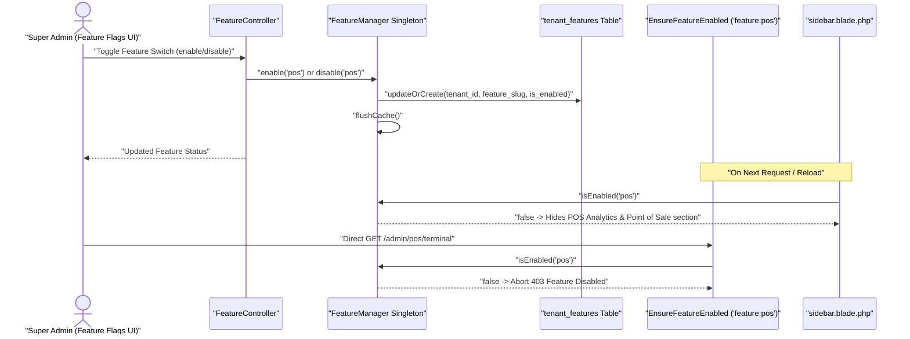

# Phase 4: Tenant Feature Flags & Modular Subscription Control

## 1. How This Benefits Your Business (Owner's Perspective)

Not every business branch—or SaaS customer—uses every module on Day 1. A wholesale distributor may only want **Inventory, Sales, Procurement, and Accounting**, while a retail branch needs **Point of Sale (POS)**, and another branch activates **HRM & Payroll** later:

1. **Instant Module Circuit Breakers**:
   From `/admin/features`, an owner or platform admin can flip any module switch (`accounting`, `inventory`, `sales`, `payments`, `procurement`, `hrm`, `pos`) **ON or OFF** for a tenant without touching code or redeploying.
2. **Simultaneous UI + Backend Enforcement**:
   Disabling a feature removes all of its links and analytics dashboards from the sidebar immediately **and** blocks direct URL/API access (`403 Forbidden`) via route middleware.
3. **Zero Performance Penalty**:
   `FeatureManager` caches the tenant's enabled features once per request so checking `$featureManager->isEnabled('pos')` 15 times while rendering the sidebar hits memory, not the database.

---

## 2. Feature Flag Execution Flow

---

## 3. How the Code Is Connected End-to-End

| Component | File Path | Responsibility |
| :--- | :--- | :--- |
| Migration | `modules/Core/Database/Migrations/2024_01_01_000010_create_tenant_features_table.php` | Stores `id`, `tenant_id`, `feature_slug`, `is_enabled`, `metadata` (JSON) |
| Model | `modules/Core/Models/TenantFeature.php` | Uses `HasUlids` and `BelongsToTenant` |
| Service | `modules/Core/Services/FeatureManager.php` | Registered as singleton in `CoreServiceProvider`; provides `isEnabled()`, `enable()`, `disable()`, `all()`, `flushCache()` |
| Middleware | `modules/Core/Http/Middleware/EnsureFeatureEnabled.php` | Aliased as `'feature'` in `bootstrap/app.php`; applied to every module route group (e.g. `->middleware(['feature:pos'])`) |
| Controller | `modules/Core/Http/Controllers/FeatureController.php` | Lists all 7 configurable modules (`accounting`, `inventory`, `sales`, `payments`, `procurement`, `hrm`, `pos`) and toggles flags; protected by `can:core.features.view` & `can:core.features.manage` |
| UI & Navigation | `resources/views/admin/features/index.blade.php`, `resources/views/admin/layouts/sidebar.blade.php` | Toggle switches UI + conditional Blade rendering using injected `FeatureManager` |
| Seeder | `modules/Core/Database/Seeders/CoreDatabaseSeeder.php` | Enables all 7 core & Wave 2 modules by default for the seeded tenant |
