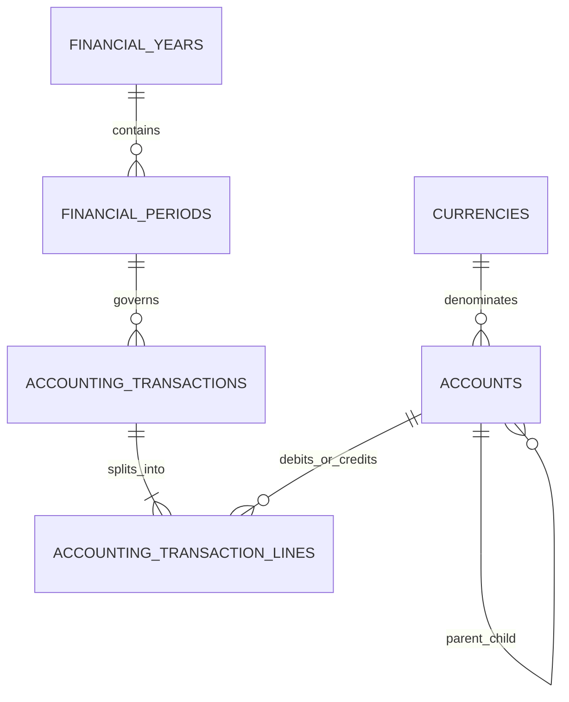
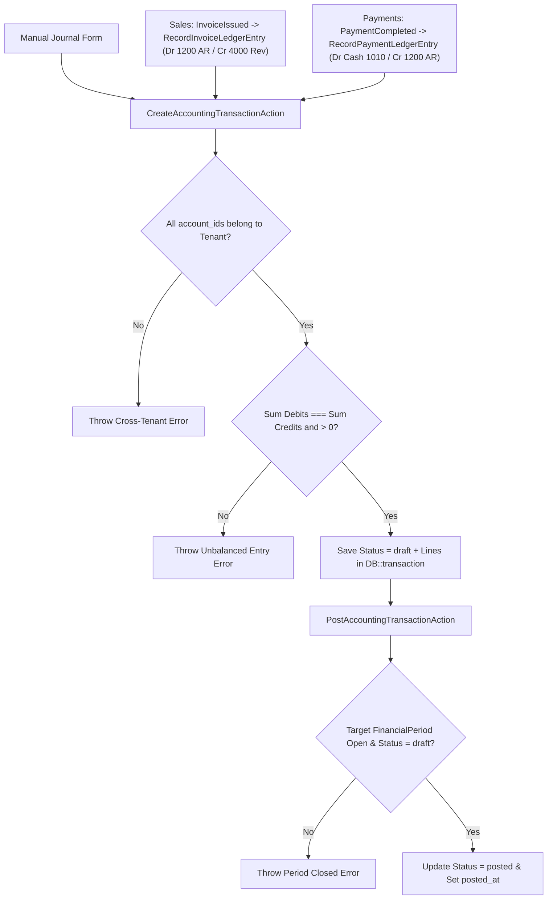

# Phase 5: Double-Entry Accounting & General Ledger (`modules/Accounting/`)

## 1. How This Benefits Your Business (Owner's Perspective)

Accounting is the single source of financial truth for your company. Instead of chasing spreadsheets at month-end, every invoice you issue and every payment you receive automatically posts balanced double-entry journal lines into your General Ledger:

1. **Chart of Accounts (`accounts`)**:
   Your financial buckets organized by standard accounting types:
   - **Assets (`1xxx`)**: What you own — e.g., Cash/Bank (`1010`), Accounts Receivable (`1200`).
   - **Liabilities (`2xxx`)**: What you owe — e.g., Accounts Payable, Taxes Payable.
   - **Equity (`3xxx`)**: Owner's capital and retained earnings.
   - **Revenue (`4xxx`)**: Income earned — e.g., Sales Revenue (`4000`).
   - **Expenses (`5xxx`+)**: Costs of goods, payroll, rent, utilities.
   Accounts support parent/child nesting (`parent_id`) so you can inspect summary totals or drill down into sub-accounts.
2. **Fiscal Governance (`financial_years` & `financial_periods`)**:
   Once an accounting month is closed (`FinancialPeriod`), nobody can accidentally backdate or alter transactions inside that closed period.
3. **The Golden Rule (`Total Debits === Total Credits`)**:
   `CreateAccountingTransactionAction` strictly refuses to save an unbalanced journal entry (`total_debits !== total_credits` or zero totals) and prevents cross-tenant account IDs (IDOR protection).
4. **Hands-Free Automation**:
   Whenever Sales issues an invoice (`InvoiceIssued`) or Payments completes a payment (`PaymentCompleted`), Accounting automatically creates and posts the matching balanced journal transaction (`AUTO-INV-...` / `AUTO-PAY-...`).

---

## 2. Accounting Diagrams

### Database Entity-Relationship Diagram

### Journal Entry Lifecycle & Auto-Posting Flow

---

## 3. How the Code Is Connected End-to-End

| Layer | Exact Files | Responsibility |
| :--- | :--- | :--- |
| Provider & Event Wiring | `modules/Accounting/Providers/AccountingServiceProvider.php` | Loads web/API routes, migrations, and wires `Event::listen(InvoiceIssued::class, RecordInvoiceLedgerEntry::class)` + `Event::listen(PaymentCompleted::class, RecordPaymentLedgerEntry::class)` |
| Migrations | `2024_01_01_000011` (`currencies`) through `000016` (`accounting_transaction_lines`) | 6 separate single-table migrations with `bigint` debit/credit cents |
| Models | `Currency`, `FinancialYear`, `FinancialPeriod`, `Account`, `AccountingTransaction`, `AccountingTransactionLine` | `HasUlids`, `BelongsToTenant`, `Auditable` |
| Form Requests | `StoreAccountRequest`, `UpdateAccountRequest`, `StoreAccountingTransactionRequest` | Validates account types, balanced lines array, fiscal dates |
| Actions | `CreateAccountAction`, `UpdateAccountAction`, `CreateAccountingTransactionAction`, `PostAccountingTransactionAction` | Transactional creation, tenant account ownership validation, double-entry check, period-lock check |
| Listeners | `RecordInvoiceLedgerEntry`, `RecordPaymentLedgerEntry` | Translates commercial events (`InvoiceIssued`, `PaymentCompleted`) into posted balanced ledger entries |
| Controllers | `FinanceDashboardController`, `AccountController`, `AccountingTransactionController` | Live KPI dashboard (`/admin/accounting/dashboard`), Chart of Accounts CRUD, Journal DataTables + Post action |
| Blade UI | `resources/views/admin/accounting/{dashboard,accounts,transactions}.blade.php` | ApexCharts cashflow/balances, CoA tree/table, Journal entry modal builder |
| Seeder | `modules/Accounting/Database/Seeders/AccountingDatabaseSeeder.php` | Seeds USD currency, active Fiscal Year/Periods, default CoA (`1010`, `1200`, `4000`, etc.) |
