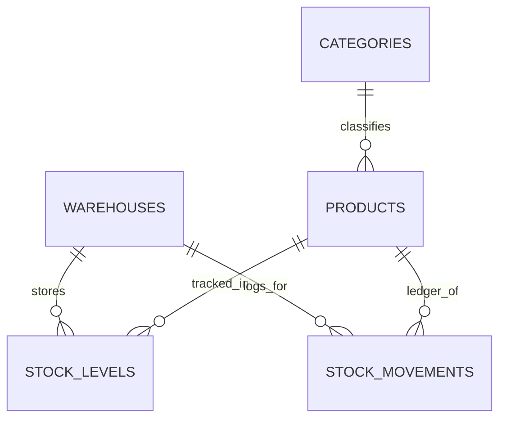
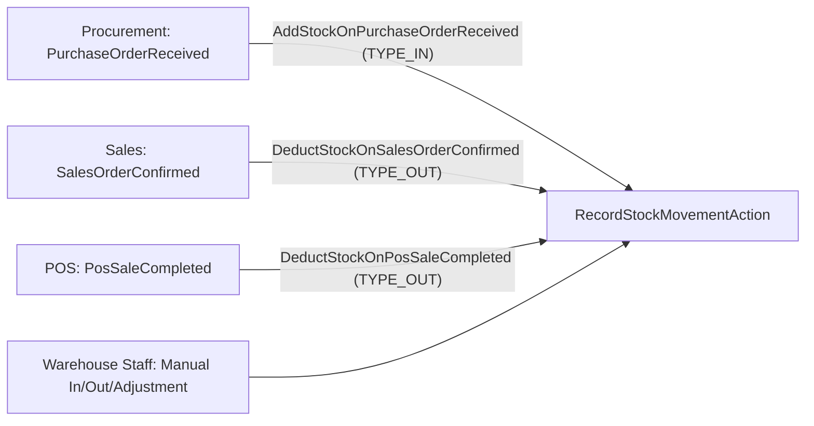
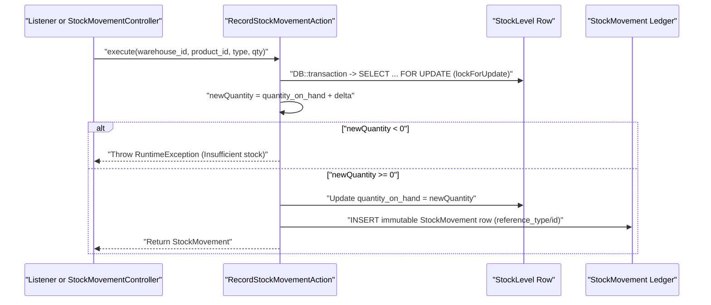

# Phase 6: Inventory, Warehouses & Immutable Stock Ledger (`modules/Inventory/`)

## 1. How This Benefits Your Business (Owner's Perspective)

Inventory is tied-up cash. If you lose track of what is in which warehouse—or allow staff to edit stock numbers silently—shrinkage and fulfillment failures follow. Phase 6 enforces strict warehouse discipline:

1. **Product Catalog (`categories` & `products`)**:
   Every item has a unique `sku`, `cost_price` (what you pay suppliers, in cents), `selling_price` (what you charge customers, in cents), `reorder_level` (triggers low-stock alerts on dashboards), and a `track_inventory` flag (allowing non-physical services alongside physical goods).
2. **Multi-Warehouse Stock Tracking (`warehouses` & `stock_levels`)**:
   You can operate Main Warehouse, Retail Backroom, or Regional Hubs separately. `stock_levels` holds exact `quantity_on_hand` and `quantity_reserved` per `(warehouse_id, product_id)` pair.
3. **Immutable Stock Ledger (`stock_movements`)**:
   Stock quantities are **never arbitrarily overwritten**. Every change (`in`, `out`, `adjustment`) appends an unchangeable `StockMovement` row recording `quantity`, `unit_cost`, `reference_type`, `reference_id`, `notes`, and `created_by`. Updating or deleting a `StockMovement` throws a `RuntimeException`.
4. **Concurrency-Safe Negative Stock Block**:
   If two sales hit the last unit in stock at the exact same millisecond, `RecordStockMovementAction` locks the `StockLevel` row (`lockForUpdate()`) inside `DB::transaction`, serves the first one, and blocks the second with `"Insufficient stock"`.

---

## 2. Inventory Diagrams

### Entity-Relationship Diagram

### Cross-Module Stock Triggers & Concurrency-Safe Movement Flow

---

## 3. How the Code Is Connected End-to-End

| Layer | Exact Files | Responsibility |
| :--- | :--- | :--- |
| Provider & Event Wiring | `modules/Inventory/Providers/InventoryServiceProvider.php` | Loads web/API routes & migrations; listens to `SalesOrderConfirmed` (`DeductStockOnSalesOrderConfirmed`), `PurchaseOrderReceived` (`AddStockOnPurchaseOrderReceived`), and `PosSaleCompleted` (`DeductStockOnPosSaleCompleted`) |
| Migrations | `2024_01_01_000017` (`categories`) through `000021` (`stock_movements`) | 5 single-table migrations |
| Models | `Category`, `Warehouse`, `Product`, `StockLevel`, `StockMovement` | `StockMovement` blocks `updating`/`deleting` with `RuntimeException` |
| Actions | `CreateCategoryAction`, `UpdateCategoryAction`, `CreateWarehouseAction`, `UpdateWarehouseAction`, `CreateProductAction`, `UpdateProductAction`, `RecordStockMovementAction` | Transactional CRUD + locked inventory ledger writes |
| Form Requests | `StoreCategoryRequest`, `UpdateCategoryRequest`, `StoreWarehouseRequest`, `UpdateWarehouseRequest`, `StoreProductRequest`, `UpdateProductRequest`, `RecordStockMovementRequest` | Validates uniqueness per tenant, prices, quantities, warehouse/product ownership |
| Listeners | `DeductStockOnSalesOrderConfirmed`, `AddStockOnPurchaseOrderReceived`, `DeductStockOnPosSaleCompleted` | Only act on items where `$product->track_inventory === true`; skip cleanly with log warning if warehouse missing or stock short |
| Controllers | `InventoryDashboardController`, `CategoryController`, `WarehouseController`, `ProductController`, `StockMovementController` | Inventory KPIs, catalog management, warehouse stock view, ledger movements |
| Blade UI | `resources/views/admin/inventory/{dashboard,warehouses}.blade.php`, `resources/views/admin/{categories,products}/*` | Stock valuation charts, low-stock alerts, DataTables |
| Seeder | `modules/Inventory/Database/Seeders/InventoryDatabaseSeeder.php` | Seeds starter categories, main warehouse, sample products, and opening stock levels |
