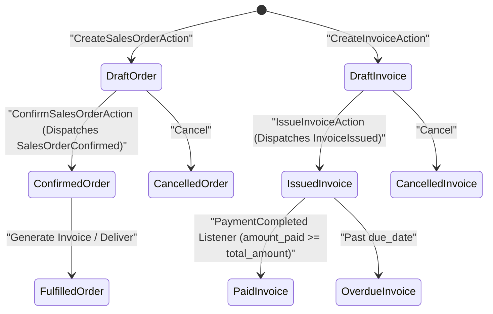
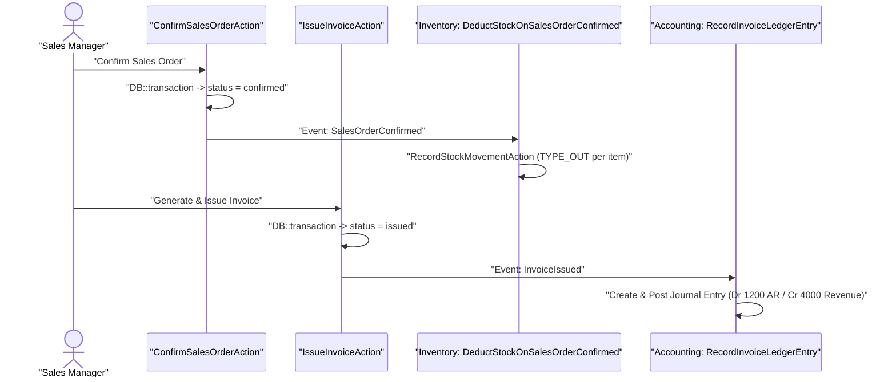
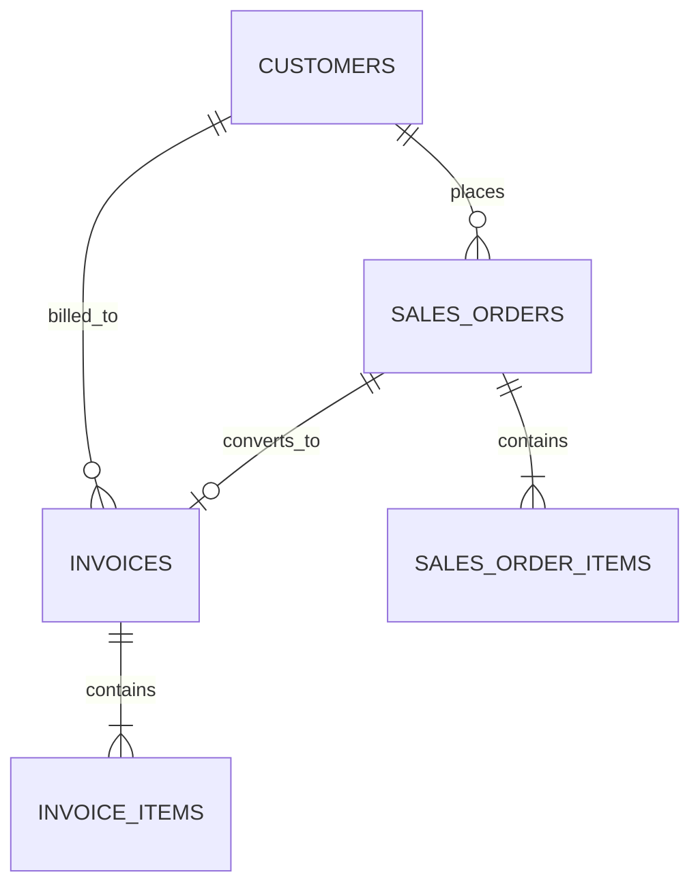

# Phase 7: B2B Sales, Orders & Invoicing (`modules/Sales/`)

## 1. How This Benefits Your Business (Owner's Perspective)

While **POS** serves fast walk-in retail tickets, the **Sales Module** powers your B2B, wholesale, and invoiced client relationships (**Order-to-Cash**):

1. **Customer Master Directory (`customers`)**:
   Tracks corporate/client accounts (`code`, `name`, `email`, `phone`, `address`, `tax_id`, `is_active`) used across both B2B Sales and POS named tickets.
2. **Sales Orders (`sales_orders` + `sales_order_items`)**:
   Before shipping goods, staff create a draft `SalesOrder` assigned to a customer and fulfilling `Warehouse`. When the manager clicks **Confirm**, `ConfirmSalesOrderAction` locks the order and dispatches `SalesOrderConfirmed` — immediately deducting stock from the warehouse so you never double-sell promised inventory.
3. **B2B Invoicing (`invoices` + `invoice_items`)**:
   - Invoices can be created standalone **or** generated in **1 click directly from a Confirmed Sales Order**.
   - **Server-Side Money Integrity**: Customers cannot tamper with totals in browser dev tools; `CreateSalesOrderAction` and `CreateInvoiceAction` compute every line subtotal, discount, tax, and `total_amount` on the server in integer cents.
   - Issuing an invoice (`IssueInvoiceAction`) dispatches `InvoiceIssued` -> Accounting automatically posts `Dr Accounts Receivable (1200) / Cr Sales Revenue (4000)`.
   - Collecting money (`PaymentCompleted`) triggers `UpdateInvoiceOnPaymentCompleted`, updating `amount_paid` and automatically flipping status to `paid` when `amount_paid >= total_amount`.

---

## 2. Sales Lifecycle & Integration Diagrams

### Order & Invoice State Transitions

### Confirm Order & Issue Invoice Sequence

### Database Entity-Relationship Diagram

---

## 3. How the Code Is Connected End-to-End

| Layer | Exact Files | Responsibility |
| :--- | :--- | :--- |
| Provider & Event Wiring | `modules/Sales/Providers/SalesServiceProvider.php` | Loads web/API routes & migrations; listens to `PaymentCompleted::class` -> `UpdateInvoiceOnPaymentCompleted::class` |
| Migrations | `2024_01_01_000022` (`customers`) through `000026` (`invoice_items`) | 5 single-table migrations |
| Models | `Customer`, `SalesOrder`, `SalesOrderItem`, `Invoice`, `InvoiceItem` | Include status constants, `balance_due` helpers, `BelongsToTenant`, `Auditable` |
| Events & Listeners | `Events/SalesOrderConfirmed`, `Events/InvoiceIssued`, `Listeners/UpdateInvoiceOnPaymentCompleted` | Syncs inventory on order confirm, posts AR revenue on invoice issue, updates `amount_paid` on payment |
| Actions | `CreateCustomerAction`, `UpdateCustomerAction`, `CreateSalesOrderAction`, `ConfirmSalesOrderAction`, `CreateInvoiceAction`, `IssueInvoiceAction` | Transactional business workflows and server-side money calculation |
| Form Requests | `StoreCustomerRequest`, `UpdateCustomerRequest`, `StoreSalesOrderRequest`, `StoreInvoiceRequest` | Validates customer/warehouse ownership and line-item arrays |
| Controllers | `SalesDashboardController`, `CustomerController`, `SalesOrderController`, `InvoiceController` | Sales analytics, customer CRUD, multi-item order & invoice management, print view |
| Blade UI | `resources/views/admin/sales/{dashboard,customers,invoices,invoice-print}.blade.php`, `resources/views/admin/orders/*` | Sales KPI charts, status filter tabs, 1-click SO->Invoice, printable PDF invoice |
| Seeder | `modules/Sales/Database/Seeders/SalesDatabaseSeeder.php` | Seeds demo customers, orders, and invoices |
