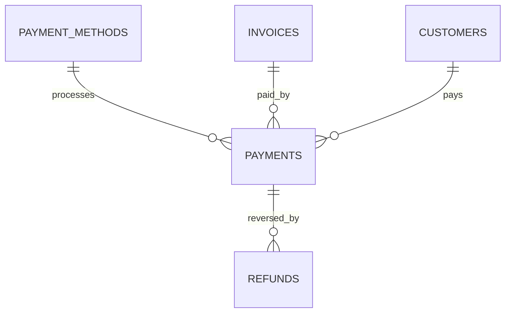
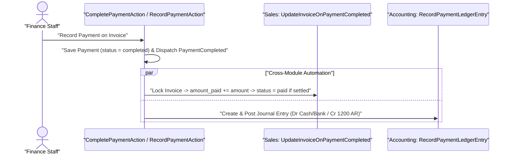
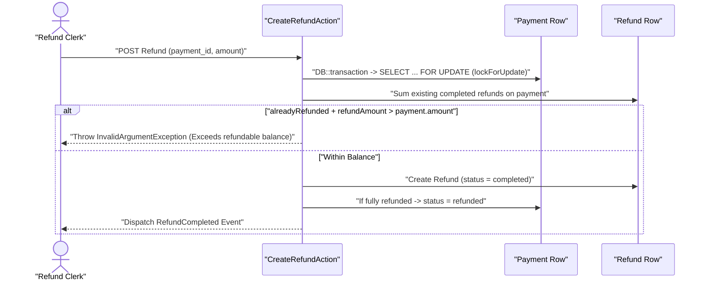

# Phase 8: Payments Collection & Concurrency-Safe Refunds (`modules/Payments/`)

## 1. How This Benefits Your Business (Owner's Perspective)

Issuing an invoice is only half the battle — cash in the bank keeps the business alive. The Payments module tracks how money comes in and protects you from refund errors or fraud:

1. **Payment Methods (`payment_methods`)**:
   Configurable tender channels (`Cash`, `Bank Transfer`, `Credit Card`, etc.), optionally mapped directly to a specific `Account` (`account_id`) in Accounting so bank deposits hit the right GL account automatically.
2. **Invoice Payments (`payments`)**:
   Staff record partial or full payments (`RecordPaymentAction` / `CompletePaymentAction`) linked to an invoice and customer. Completing a payment fires `PaymentCompleted`, triggering **two automatic cross-module actions**:
   - **Sales**: `UpdateInvoiceOnPaymentCompleted` adds the payment to `invoice.amount_paid` and marks the invoice `paid` once the balance hits zero.
   - **Accounting**: `RecordPaymentLedgerEntry` debits the Payment Method's Cash/Bank account (`account_id` or `1010`) and credits Accounts Receivable (`1200`).
3. **Double-Refund Prevention (`refunds`)**:
   What happens if two support agents try to refund the same `$500` payment at the exact same second? `CreateRefundAction` locks the `Payment` row (`lockForUpdate()`) inside `DB::transaction`, sums prior completed refunds, and rejects any refund exceeding the remaining refundable balance.

---

## 2. Payments & Refunds Diagrams

### Entity-Relationship Diagram

### Payment Completion & Concurrency-Safe Refund Sequences

---

## 3. How the Code Is Connected End-to-End

| Layer | Exact Files | Responsibility |
| :--- | :--- | :--- |
| Provider | `modules/Payments/Providers/PaymentsServiceProvider.php` | Loads `api.php` (`/api/v1/payments/*`), `web.php`, and migrations |
| Migrations | `2024_01_01_000027` (`payment_methods`), `000028` (`payments`), `000029` (`refunds`) | 3 single-table migrations |
| Models | `PaymentMethod`, `Payment`, `Refund` | Include `amount`, status constants (`completed`, `refunded`, etc.), `BelongsToTenant`, `Auditable` |
| Events | `Events/PaymentCompleted`, `Events/RefundCompleted` | Consumed by `Sales` (updates invoice balance) and `Accounting` (posts Cash/AR ledger) |
| Actions | `CreatePaymentMethodAction`, `UpdatePaymentMethodAction`, `RecordPaymentAction`, `CompletePaymentAction`, `CreateRefundAction` | Enforces unique payment/refund numbers per tenant, row-level locking on refunds |
| Form Requests | `StorePaymentMethodRequest`, `UpdatePaymentMethodRequest`, `StorePaymentRequest`, `StoreRefundRequest` | Validates positive minor-unit amounts, dates, and payment ownership |
| Controllers | `PaymentMethodController`, `PaymentController`, `RefundController` | DataTables JSON endpoints, create/complete/refund actions |
| Blade UI | `resources/views/admin/payments/{index,refunds}.blade.php` | Payments & Payment Methods screen, Refunds tracking table |
| Seeder | `modules/Payments/Database/Seeders/PaymentsDatabaseSeeder.php` | Seeds Cash, Bank Transfer, and Card methods plus initial payments |
