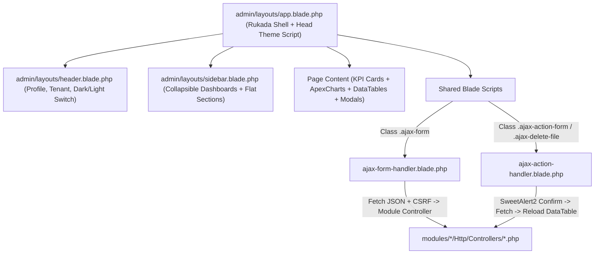

# Phase 9: Admin Web Portal & Rukada Blade Integration

## 1. How This Benefits Your Business (Owner's Perspective)

Backend databases and APIs only create business value when staff can operate them effortlessly without technical training. Phase 9 integrates all modules into a unified **Rukada Bootstrap 5 Web Portal** (`/admin/*`):

1. **One Cohesive Workplace (`resources/views/admin/layouts/app.blade.php`)**:
   Instead of jarring full-page reloads on every button click, forms and table actions work over **AJAX + SweetAlert2**, giving staff instant validation feedback and refreshing Server-Side DataTables automatically.
2. **Permission & Feature-Aware Navigation (`sidebar.blade.php`)**:
   Staff only see modules that are both **enabled for the company (`FeatureManager::isEnabled()`)** and **permitted for their role (`@can(...)`)**.
3. **Zero-Flicker Dark / Light Theme Persistence**:
   Theme preference is stored in browser `localStorage` and restored immediately in `<head>` before first paint so dark mode never flashes white on page refresh.
4. **Session & Auth Integration**:
   Expired sessions redirect cleanly to `route('admin.login')` via `bootstrap/app.php` (`redirectGuestsTo`), preventing broken routes or unhandled errors.

---

## 2. Web Portal Architecture & Shared UI Flow

---

## 3. How the Code Is Connected End-to-End

| Component | Exact Path | Role |
| :--- | :--- | :--- |
| Main App Shell | `resources/views/admin/layouts/app.blade.php` | Loads Bootstrap 5, Boxicons, MetisMenu, ApexCharts, DataTables, SweetAlert2, CSRF meta tag, and shared scripts |
| Navigation Sidebar | `resources/views/admin/layouts/sidebar.blade.php` | Single collapsible `Dashboards` dropdown + flat module sections (`menu-label`) controlled by `$featureManager->isEnabled()` and `@can()` |
| Top Header & Theme Customizer | `resources/views/admin/layouts/{header,theme-customizer,footer}.blade.php` | Top search/user menu, persisted dark/light switcher, theme panel |
| Shared AJAX Helpers | `resources/views/admin/components/{ajax-form-handler,ajax-action-handler,ajax-delete-file-handler,flash-messages}.blade.php` | Unified form submission, field validation error highlighting, SweetAlert2 delete/confirm prompts, and DataTable reload |
| Login & Profile UI | `resources/views/admin/auth/login.blade.php`, `resources/views/admin/profile/{profile,change_password}.blade.php` | Backed by `Modules\Users\Http\Controllers\AdminAuthController` & `ProfileController` |
| Web Entry Redirect | `routes/web.php` -> `route('admin.dashboard')` | All admin routes are loaded straight from each `modules/<Domain>/routes/web.php` inside `['web', 'auth', 'tenant', 'tenant.active']` |
