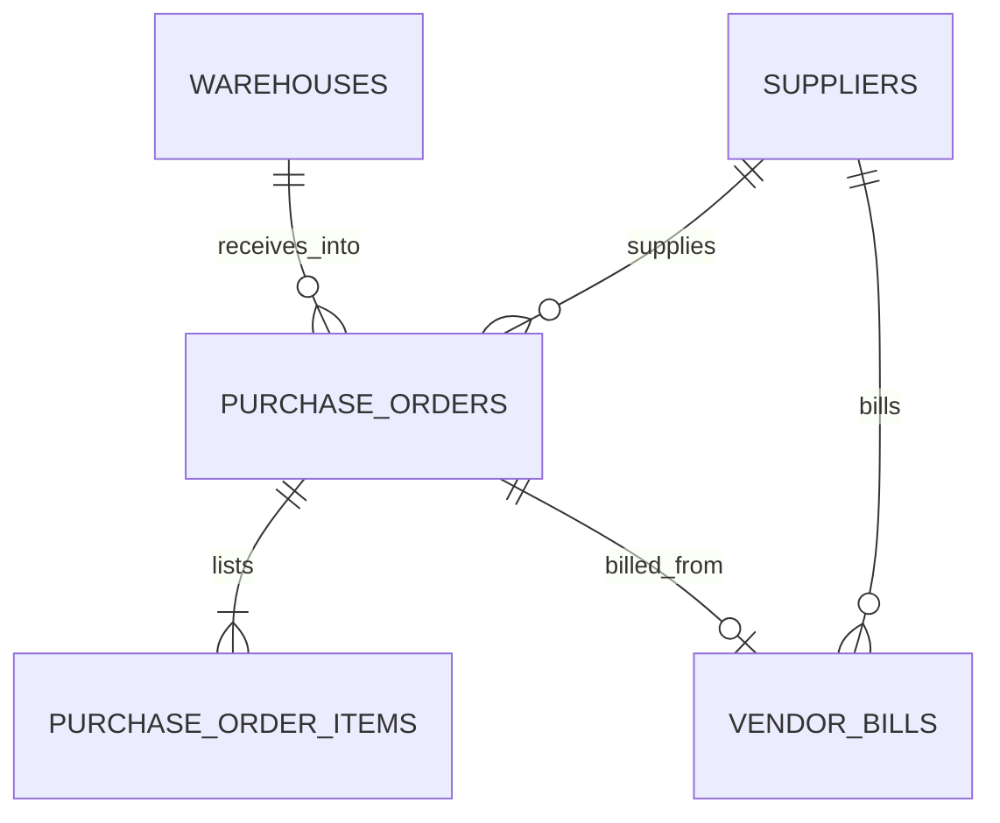
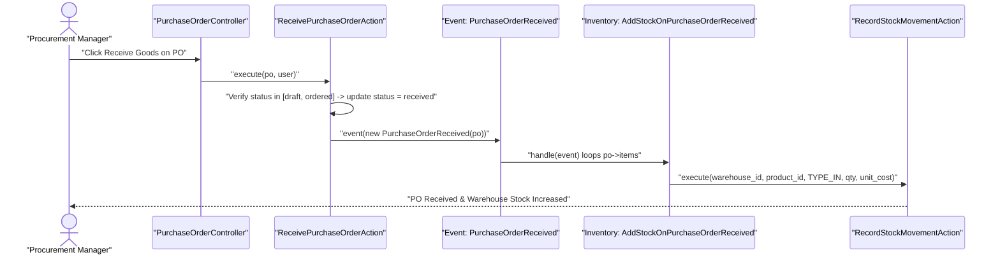

# Phase 10: Wave 2 — Procurement (`modules/Procurement/`) & Complete Invoice Service

## 1. How This Benefits Your Business (Owner's Perspective)

Every retail or wholesale company has two sides to cashflow: collecting money from customers (**Order-to-Cash**) and buying goods/paying bills to vendors (**Procure-to-Pay**). Phase 10 completes both:

1. **Procurement (`modules/Procurement/`) — Buying Stock Without Double Entry**:
   - **Suppliers (`suppliers`)**: Directory of your vendors, tax IDs, contacts, and active status.
   - **Purchase Orders (`purchase_orders` + `purchase_order_items`)**: Multi-item PO builder selecting vendor, destination `Warehouse`, expected date, and unit costs (in cents).
   - **One-Click Goods Receipt**: When stock arrives at the loading dock and a manager clicks **Receive Goods**, `ReceivePurchaseOrderAction` marks the PO `received` and dispatches `PurchaseOrderReceived`. **Inventory listens automatically** (`AddStockOnPurchaseOrderReceived`) and writes `StockMovement (TYPE_IN)` into the exact warehouse — zero manual stock re-entry.
   - **Vendor Bills (`vendor_bills`)**: Accounts Payable tracking linked to Suppliers/POs with **Approve & Mark Paid** workflows.
2. **Complete B2B Invoice Service (`modules/Sales/`)**:
   - **Status Filter Tabs**: Filter Server-Side DataTables cleanly by All / Draft / Issued / Paid / Overdue / Cancelled.
   - **One-Click SO-to-Invoice Conversion**: Convert Confirmed Sales Orders straight into Invoices with calculated `balance_due`.
   - **Print / Save PDF Invoice**: Clean dedicated print layout (`admin/sales/invoice-print.blade.php`) plus Quick Payment collection modal right from Issued/Overdue invoices.

---

## 2. Procure-to-Pay Diagrams

### Database Entity-Relationship Diagram

### Receive Goods -> Auto-Stock IN Sequence

---

## 3. How the Code Is Connected End-to-End

| Layer | Exact Files | Responsibility |
| :--- | :--- | :--- |
| Provider | `modules/Procurement/Providers/ProcurementServiceProvider.php` | Loads `modules/Procurement/routes/web.php` & migrations |
| Cross-Module Listener | `modules/Inventory/Listeners/AddStockOnPurchaseOrderReceived.php` | Registered in `InventoryServiceProvider`; converts received PO lines into `StockMovement::TYPE_IN` |
| Migrations | `2024_01_01_000030` (`suppliers`) through `000033` (`vendor_bills`) | 4 single-table migrations |
| Models | `Supplier`, `PurchaseOrder`, `PurchaseOrderItem`, `VendorBill` | `HasUlids`, `BelongsToTenant`, `Auditable` |
| Actions | `CreateSupplierAction`, `UpdateSupplierAction`, `CreatePurchaseOrderAction`, `ReceivePurchaseOrderAction`, `CreateVendorBillAction`, `ApproveVendorBillAction` | Server-side PO total calculation, receiving state guard, bill approval/payment |
| Form Requests | `StoreSupplierRequest`, `UpdateSupplierRequest`, `StorePurchaseOrderRequest`, `StoreVendorBillRequest` | Input validation & tenant isolation |
| Controllers | `ProcurementDashboardController`, `SupplierController`, `PurchaseOrderController`, `VendorBillController` | Procurement KPIs, CRUD DataTables, PO receiving, bill workflow |
| Blade UI | `resources/views/admin/procurement/{dashboard,suppliers,purchase-orders,vendor-bills}.blade.php`, `resources/views/admin/sales/invoice-print.blade.php` | ApexCharts spend analytics, PO modal builder, Vendor Bills workflow, Invoice PDF view |
| Seeder | `modules/Procurement/Database/Seeders/ProcurementDatabaseSeeder.php` | Seeds demo suppliers, POs, and vendor bills |
