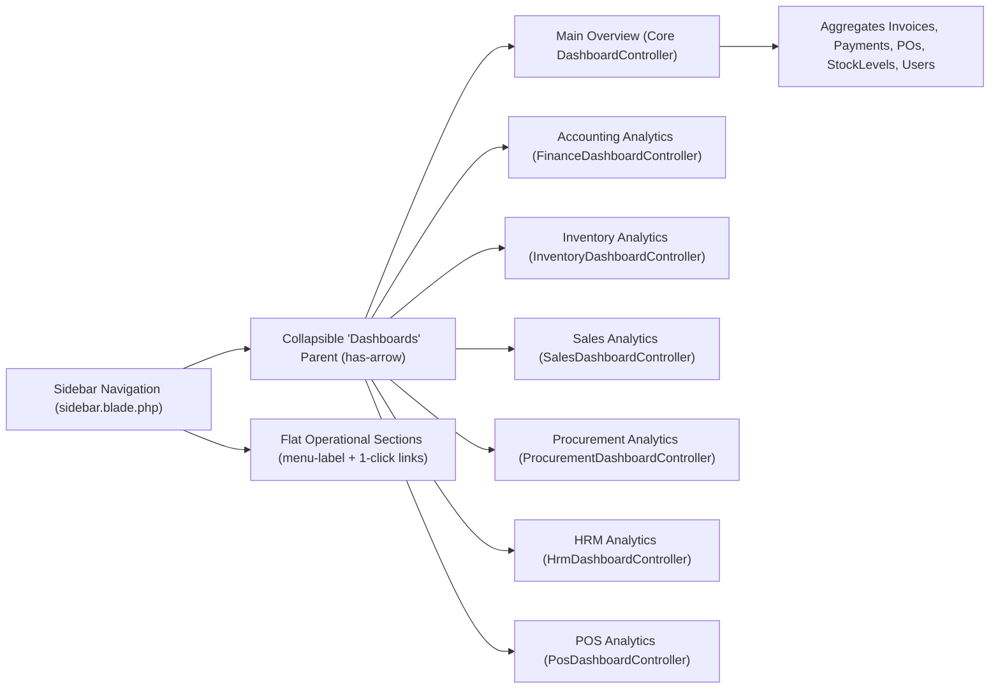

# Phase 11: Executive Analytics Hub, Sidebar UX & Organization Management

## 1. How This Benefits Your Business (Owner's Perspective)

An owner shouldn't have to export 5 CSVs to understand company health. Phase 11 brings **every department's KPIs and interactive ApexCharts** into one organized navigation structure alongside full **Organization & Staff Management**:

1. **Collapsible `Dashboards` Hub + Flat Operational Sections**:
   - The sidebar groups all **8 live analytics dashboards** (`Main Overview`, `Accounting Analytics`, `Inventory Analytics`, `Sales Analytics`, `Payments Analytics`, `Procurement Analytics`, `HRM Analytics`, `POS Analytics`) inside one collapsible `Dashboards` dropdown at the top.
   - Every operational department below (`Administration`, `Core Finance`, `Sales & Billing`, `Point of Sale`, `Inventory & Stock`, `Procurement`, `HRM & Payroll`, `Organization & Staff`, `RBAC & Security`) uses flat section headers (`menu-label`) without nested collapse clutter, so daily staff reach any screen in one click.
2. **Real-Time Executive KPIs (`DashboardController`)**:
   Reads live data directly from `Invoice`, `Payment`, `SalesOrder`, `Product`, `StockLevel`, `PurchaseOrder`, `Account`, and `AccountingTransaction` to plot 6-month **Revenue vs Cash Collected vs Procurement Spend**, collection rates, fulfillment rates, and low-stock health.
3. **Organization & Staff Operations (`OrganizationController`)**:
   Lets admins manage **Departments**, nested **Teams**, team membership rosters, and **Staff Users** (`CreateStaffUserAction`, `UpdateStaffUserAction`) inside dedicated Rukada DataTables screens.

---

## 2. Executive Hub & Sidebar Architecture Diagram

---

## 3. How the Code Is Connected End-to-End

| Area | Exact Files | Responsibility |
| :--- | :--- | :--- |
| Executive Dashboard | `modules/Core/Http/Controllers/DashboardController.php` & `resources/views/admin/dashboard.blade.php` | Computes live KPIs, 6-month Revenue/Collected/Spend series, collection & fulfillment rates, and ApexCharts visualizations |
| Department Dashboards | `FinanceDashboardController`, `InventoryDashboardController`, `SalesDashboardController`, `ProcurementDashboardController`, `HrmDashboardController`, `PosDashboardController` | Dedicated KPIs and ApexCharts per module inside `resources/views/admin/*/dashboard.blade.php` |
| Navigation Layout | `resources/views/admin/layouts/sidebar.blade.php` | Combines `FeatureManager::isEnabled('<module>')` + `@can('<permission>')` to render the collapsible `Dashboards` parent and flat operational sections |
| Organization UI & Logic | `modules/Users/Http/Controllers/OrganizationController.php` & `resources/views/admin/organization/{departments,teams,staff}.blade.php` | Department, Team hierarchy, and Staff creation/editing powered by `modules/Users/Actions/*` |
