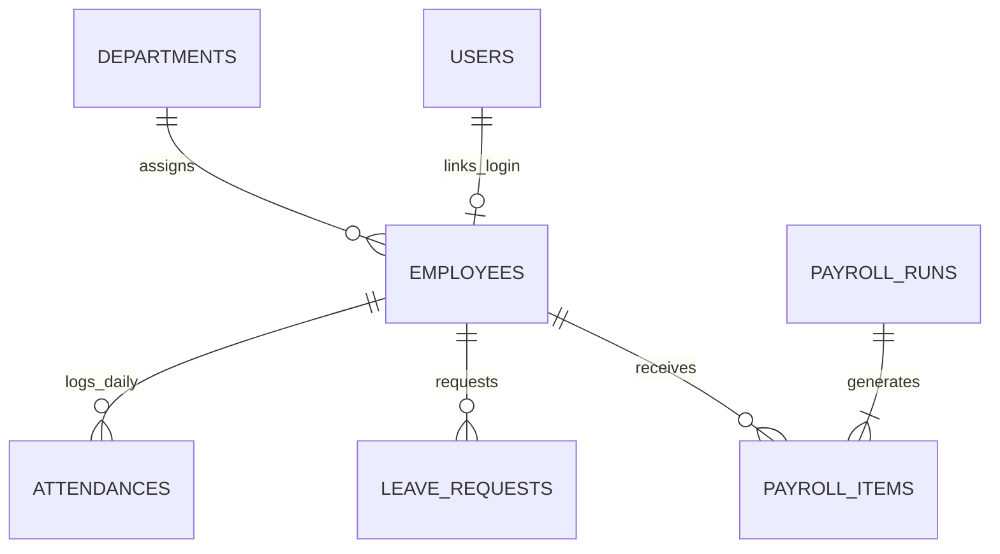
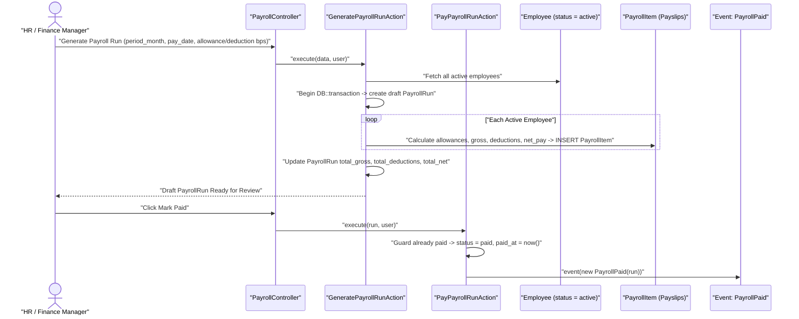

# Phase 12: Wave 2 — Human Resource Management (HRM) & Payroll Engine (`modules/Hrm/`)

## 1. How This Benefits Your Business (Owner's Perspective)

People are both your greatest capability and often your largest monthly expense. The HRM module turns messy spreadsheets into a structured **Hire-to-Pay** workflow:

1. **Employee Directory (`employees`)**:
   Stores each staff member's `employee_code`, `Department` assignment, job title, hire date, employment type, `base_salary` (in cents), and active/terminated status — optionally linked to a login `User` account (`user_id`).
2. **Daily Time & Attendance (`attendances`)**:
   Tracks daily `check_in`, `check_out`, work date, and status (`present`, `late`, `absent`, `half_day`) via `RecordAttendanceAction`.
3. **Leave Requests & Approval (`leave_requests`)**:
   Employees/managers log leave (`annual`, `sick`, `unpaid`, etc.) with `start_date`, `end_date`, and `days_count`; managers review via `ReviewLeaveRequestAction` to `approve` or `reject` with reviewer timestamps.
4. **Automated Monthly Payroll Runs (`payroll_runs` + `payroll_items`)**:
   - At payday, Finance/HR runs `GeneratePayrollRunAction` for a month (e.g., `2026-11`), passing optional allowance and deduction basis points (`default_allowance_bps`, `default_deduction_bps`).
   - Inside a single atomic `DB::transaction`, the engine loops through **every `active` employee**, computes `base_salary`, `allowances`, `gross`, `deductions`, and `net_pay`, creates individual `PayrollItem` payslips, and saves run totals (`total_gross`, `total_deductions`, `total_net`).
   - Once reviewed, clicking **Pay Payroll Run** executes `PayPayrollRunAction`, locking status as `paid`, stamping `paid_at`, and dispatching `PayrollPaid`.

---

## 2. HRM & Payroll Diagrams

### Database Entity-Relationship Diagram

### Monthly Payroll Generation & Payment Sequence

---

## 3. How the Code Is Connected End-to-End

| Layer | Exact Files | Responsibility |
| :--- | :--- | :--- |
| Provider | `modules/Hrm/Providers/HrmServiceProvider.php` | Loads `modules/Hrm/routes/web.php` & migrations |
| Migrations | `2024_01_01_000034` (`employees`) through `000038` (`payroll_items`) | 5 single-table migrations with `bigint` salary/pay cents |
| Models | `Employee`, `Attendance`, `LeaveRequest`, `PayrollRun`, `PayrollItem` | `HasUlids`, `BelongsToTenant` (tenant models), `Auditable` |
| Events | `modules/Hrm/Events/PayrollPaid.php` | Broadcasts completed payroll disbursements for audit/future ledger hooks |
| Actions | `CreateEmployeeAction`, `UpdateEmployeeAction`, `RecordAttendanceAction`, `CreateLeaveRequestAction`, `ReviewLeaveRequestAction`, `GeneratePayrollRunAction`, `PayPayrollRunAction` | Transactional HR operations and batch payslip generation |
| Form Requests | `StoreEmployeeRequest`, `UpdateEmployeeRequest`, `StoreAttendanceRequest`, `StoreLeaveRequest`, `StorePayrollRunRequest` | Validates dates, salaries, basis points, and department links |
| Controllers | `HrmDashboardController`, `EmployeeController`, `AttendanceController`, `LeaveRequestController`, `PayrollController` | HRM Analytics KPIs + ApexCharts, DataTables JSON, and CRUD/action endpoints |
| Blade UI | `resources/views/admin/hrm/{dashboard,employees,attendance,leaves,payroll}.blade.php` | Headcount/payroll charts, staff DataTables, attendance logger, leave approvals, payroll wizard |
| Seeder | `modules/Hrm/Database/Seeders/HrmDatabaseSeeder.php` | Seeds employees, attendance history, leave requests, and sample payroll run |
