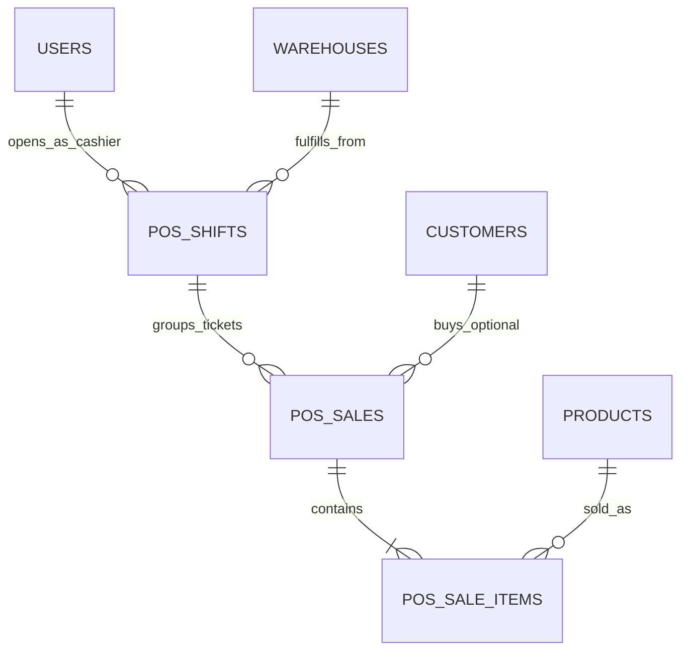
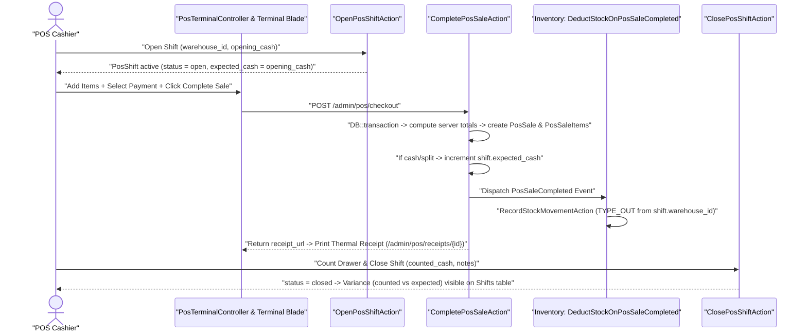

# Phase 13: Wave 2 — Point of Sale (POS) & Register Shift Management (`modules/Pos/`)

## 1. How This Benefits Your Business (Owner's Perspective)

Walk-in retail counters cannot wait for multi-step Sales Order -> Invoice forms. Cashiers need instant search, drawer cash control, printed receipts, and automatic inventory sync:

1. **Cash Drawer Shift Accountability (`pos_shifts`)**:
   - Before ringing a single item, a cashier opens a shift (`OpenPosShiftAction`) linked to a **specific fulfilling `Warehouse`** and enters the **Opening Cash Float** (e.g., `$200.00`). Only one open shift per cashier is allowed at a time.
   - As `cash` or `split` sales happen, `expected_cash` automatically climbs in the background.
   - At shift end, the cashier counts the physical drawer and submits `ClosePosShiftAction`, recording `counted_cash`, timestamp, and closing notes for owner reconciliation against `expected_cash`.
2. **Fast Interactive Checkout (`pos_sales` + `pos_sale_items`)**:
   - Cashiers filter the live product grid by SKU/name or category, add items to the ticket, choose a Customer or Walk-in, apply optional discounts/tax rate, select `cash`, `card`, or `split`, and compute exact `change_due` in cents.
   - Clicking **Complete Sale** runs `CompletePosSaleAction` inside an atomic `DB::transaction`: verifies the shift is still `open`, calculates line prices & taxes on the server from `Product::selling_price`, saves the receipt (`RCP-...`), increments drawer cash if applicable, and dispatches `PosSaleCompleted`.
3. **Automatic Warehouse Stock Deduction**:
   **Inventory listens automatically** (`DeductStockOnPosSaleCompleted`) to `PosSaleCompleted`, calling `RecordStockMovementAction` (`TYPE_OUT`) for every tracked item from the **active shift's `warehouse_id`** — so retail counter sales immediately update real-time warehouse levels and prevent overselling!

---

## 2. POS Diagrams

### Database Entity-Relationship Diagram

### Complete Shift & Checkout Lifecycle Sequence

---

## 3. How the Code Is Connected End-to-End

| Layer | Exact Files | Responsibility |
| :--- | :--- | :--- |
| Provider | `modules/Pos/Providers/PosServiceProvider.php` | Explicitly registered in `bootstrap/providers.php`; loads `modules/Pos/routes/web.php` & migrations |
| Cross-Module Listener | `modules/Inventory/Listeners/DeductStockOnPosSaleCompleted.php` | Registered in `InventoryServiceProvider`; deducts tracked product quantities from `$sale->shift->warehouse_id` |
| Migrations | `2024_01_01_000039` (`pos_shifts`), `000040` (`pos_sales`), `000041` (`pos_sale_items`) | 3 single-table migrations with `bigint` cents |
| Models | `PosShift`, `PosSale`, `PosSaleItem` | `HasUlids`, `BelongsToTenant`, `Auditable` |
| Events | `modules/Pos/Events/PosSaleCompleted.php` | Bridges completed retail tickets to Inventory stock movements |
| Actions | `OpenPosShiftAction`, `ClosePosShiftAction`, `CompletePosSaleAction` | Guard against duplicate open shifts, server-side pricing/tax math, cash expectation updates |
| Form Requests | `OpenPosShiftRequest`, `ClosePosShiftRequest`, `CompletePosSaleRequest` | Validates warehouse ownership, non-negative amounts, positive item quantities |
| Controllers | `PosDashboardController`, `PosTerminalController`, `PosShiftController` | Analytics (`/admin/pos/dashboard`), POS terminal & receipt (`/admin/pos/terminal`, `checkout`, `receipts/{id}`), Shift & Sales DataTables + open/close endpoints |
| Blade UI | `resources/views/admin/pos/{dashboard,terminal,receipt,shifts}.blade.php` | ApexCharts daily revenue & payment mix, interactive register grid, printable thermal receipt, shifts reconciliation DataTables |
| Permissions & Feature | `pos` feature flag + `pos.terminal.view`, `pos.sales.create`, `pos.shifts.view`, `pos.shifts.manage` | Configured in `CoreDatabaseSeeder`, `FeatureController`, `UsersDatabaseSeeder`, `PosDatabaseSeeder` |
