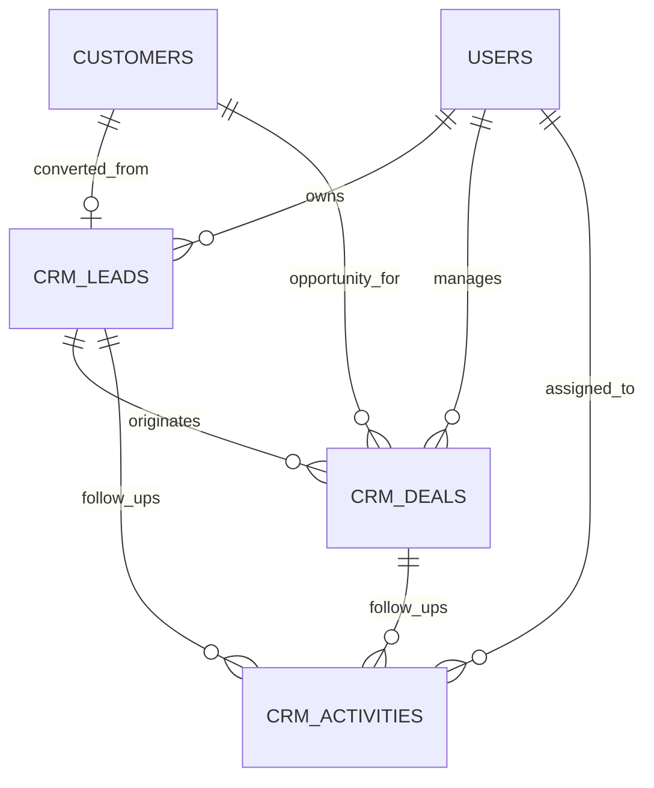
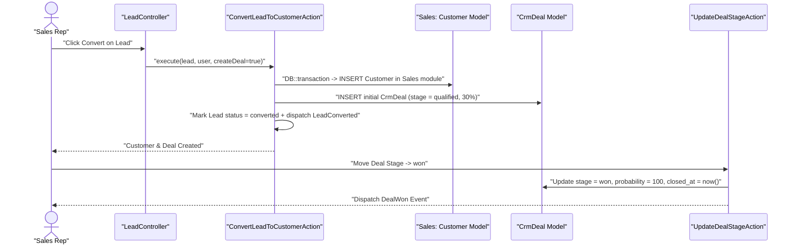

# Phase 14: Wave 3 — CRM (Leads, Deals Pipeline & Activities) (`modules/Crm/`)

## 1. How This Benefits Your Business (Owner's Perspective)

Sales orders only capture customers who are already ready to buy. Before someone becomes a paying client, your team needs a disciplined funnel to capture prospects, follow up on time, and forecast incoming revenue:

1. **Lead Capture & 1-Click Conversion (`crm_leads`)**:
   - Tracks every inbound or outbound prospect (`website`, `referral`, `cold_call`, `social`, `event`) with contact info, owner, and `estimated_value` (in cents).
   - When a lead is ready, clicking **Convert** runs `ConvertLeadToCustomerAction` inside an atomic `DB::transaction`: it automatically creates a real B2B `Customer` in `modules/Sales/`, opens an initial `CrmDeal` opportunity linked to that customer, marks the lead `converted`, and dispatches `LeadConverted`.
2. **Deals Pipeline & Revenue Forecasting (`crm_deals`)**:
   - Tracks every active commercial opportunity through 5 stages (`qualified` 25% -> `proposal` 50% -> `negotiation` 75% -> `won` 100% / `lost` 0%) with expected close dates and monetary values in cents.
   - Moving a deal to `won` (`UpdateDealStageAction`) stamps `closed_at` and dispatches `DealWon`.
3. **Follow-up Activities (`crm_activities`)**:
   - Schedules calls, emails, meetings, and tasks tied to specific Leads or Deals so no prospect slips through the cracks.

---

## 2. CRM Diagrams

### Database Entity-Relationship Diagram

### Lead-to-Customer & Deal Won Sequence

---

## 3. How the Code Is Connected End-to-End

| Layer | Exact Files | Responsibility |
| :--- | :--- | :--- |
| Provider | `modules/Crm/Providers/CrmServiceProvider.php` | Explicitly registered in `bootstrap/providers.php`; loads `modules/Crm/routes/web.php` & migrations |
| Migrations | `2024_01_01_000042` (`crm_leads`), `000043` (`crm_deals`), `000044` (`crm_activities`) | 3 single-table migrations with ULIDs and `bigint` cents |
| Models | `CrmLead`, `CrmDeal`, `CrmActivity` | `HasUlids`, `BelongsToTenant`, `Auditable` |
| Events | `Events/LeadConverted`, `Events/DealWon` | Domain events for cross-module notifications/automation |
| Actions | `CreateLeadAction`, `UpdateLeadAction`, `ConvertLeadToCustomerAction`, `CreateDealAction`, `UpdateDealStageAction`, `CreateActivityAction`, `CompleteActivityAction` | Transactional lead conversion into `Sales\Models\Customer`, stage probability sync, activity completion |
| Form Requests | `StoreLeadRequest`, `UpdateLeadRequest`, `StoreDealRequest`, `UpdateDealStageRequest`, `StoreActivityRequest` | Strict request validation rules |
| Controllers | `CrmDashboardController`, `LeadController`, `DealController`, `ActivityController` | Live CRM analytics, Server-Side DataTables, convert/stage/complete JSON endpoints |
| Blade UI | `resources/views/admin/crm/{dashboard,leads,deals,activities}.blade.php` | ApexCharts pipeline & lead-source charts, DataTables with status/stage filters, SweetAlert2 convert flow |
| Permissions & Feature | `crm` feature flag + `crm.leads.*`, `crm.deals.*`, `crm.activities.*` | Wired in `CoreDatabaseSeeder`, `FeatureController`, `UsersDatabaseSeeder`, `CrmDatabaseSeeder` |
