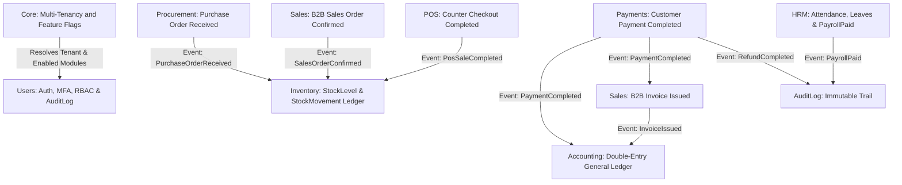
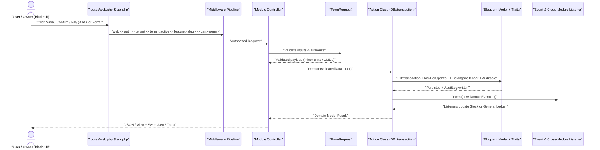

# Master ERP Owner's Handbook & Architecture Blueprint (`docs/phases/`)

This handbook explains the entire ERP from two perspectives simultaneously:
1. **How you run the business (Owner's Perspective)**: What every department does, how money and physical stock flow, and how financial controls protect the company.
2. **How the software enforces those rules (Technical Architecture)**: How the Laravel 11 Static Modular Monolith connects Blade screens, middleware, transactional `Action` classes, immutable ledgers, and cross-module domain events.

---

## 1. How Your Business Operates Inside This ERP

Think of this system as **9 specialized departments** inside one secure building (`Static Modular Monolith`). Every department keeps its own ledgers and rules, and whenever something important happens (you sell goods, receive inventory from a vendor, collect cash, or run payroll), departments automatically notify each other without manual double entry:

- **Core (`modules/Core/`)**: The building itself — separates multiple companies/branches (**Tenants**) on one server and provides master on/off breakers (**Feature Flags**) per module.
- **Users, RBAC & Organization (`modules/Users/`)**: Front-desk security & HR org chart — controls login, 2FA (TOTP), device sessions, roles/permissions (`can:module.resource.action`), `Departments`, `Teams`, and an **immutable Audit Log** recording every change.
- **Inventory (`modules/Inventory/`)**: Your warehouse floor — tracks `Categories`, `Products` (SKU, cost, selling price), `Warehouses`, real-time `StockLevel` quantities, and an **immutable `StockMovement` ledger** that refuses negative stock.
- **Procurement (`modules/Procurement/`)**: Your purchasing desk (**Procure-to-Pay**) — manages `Suppliers`, raises `PurchaseOrders`, receives deliveries (automatically adding warehouse stock), and logs/pays `VendorBills`.
- **Sales (`modules/Sales/`)**: Your B2B wholesale/client sales desk (**Order-to-Cash**) — manages `Customers`, creates and confirms `SalesOrders` (automatically deducting warehouse stock), and issues `Invoices`.
- **Point of Sale (`modules/Pos/`)**: Your retail walk-in counter — opens cash register `PosShifts`, processes quick barcode/product-grid `PosSales` with change calculation & thermal receipts, deducts warehouse stock automatically, and reconciles drawer cash at close.
- **Payments (`modules/Payments/`)**: Your cashier & treasury desk — collects partial or full invoice `Payments` (automatically marking invoices `paid`) and processes concurrency-safe `Refunds`.
- **Accounting (`modules/Accounting/`)**: Your General Ledger — enforces **Double-Entry Accounting (`Total Debits === Total Credits`)**, Fiscal Years/Periods, and **automatically posts journal entries** whenever B2B invoices are issued or payments arrive.
- **HRM & Payroll (`modules/Hrm/`)**: Your workforce desk (**Hire-to-Pay**) — manages `Employees`, daily `Attendance`, `LeaveRequests`, and monthly batch `PayrollRuns`.

---

## 2. Master Business Ecosystem Diagram (Cross-Module Event Wiring)

Every arrow below represents a real automated business reaction wired through Laravel events in the `*ServiceProvider.php` files:

### Real-World Business Loops Explained
1. **Procure-to-Pay (Buying Stock)**: Create PO -> Receive Goods (`PurchaseOrderReceived`) -> Inventory automatically adds `StockMovement (in)` -> Log Vendor Bill -> Approve & Pay Bill.
2. **B2B Order-to-Cash (Wholesale & Corporate Clients)**: Create Sales Order -> Confirm Order (`SalesOrderConfirmed`) -> Inventory automatically deducts `StockMovement (out)` -> Issue Invoice (`InvoiceIssued`) -> Accounting automatically debits Accounts Receivable (`1200`) & credits Sales Revenue (`4000`) -> Record Payment (`PaymentCompleted`) -> Sales marks Invoice `paid` & Accounting debits Cash/Bank (`1010`) & credits Accounts Receivable (`1200`).
3. **Retail Counter (POS)**: Open Shift with Opening Cash Float -> Ring up Sale -> Receipt printed + `expected_cash` updated + Inventory automatically deducts stock (`PosSaleCompleted`) -> Close Shift & count physical drawer cash.
4. **Hire-to-Pay (Staff & Salaries)**: Add Employee in Department -> Track Attendance & Approve Leaves -> Generate Monthly Payroll Run (computes all active employee payslips inside one database transaction) -> Pay Payroll Run (`PayrollPaid`).

---

## 3. Master Request Lifecycle (How Every Button Click Flows Through Code)

---

## 4. Complete Phase Index (13 Phases)

| Phase | Guide | Primary Module(s) | Business Area |
| :--- | :--- | :--- | :--- |
| 1 | [Phase 1: Foundation & Static Modular Architecture](01-foundation-and-architecture.md) | `bootstrap/`, Root | Architecture, ULIDs, Money in Cents, Quality |
| 2 | [Phase 2: Multi-Tenancy, Auth, MFA & Sessions](02-multi-tenancy-and-auth.md) | `modules/Core/`, `modules/Users/` | Tenant Isolation, Login Lockout, TOTP MFA |
| 3 | [Phase 3: RBAC, Organization Hierarchy & Audit Trail](03-rbac-organization-and-audit.md) | `modules/Users/` | Roles, Permissions, Departments, Teams, AuditLog |
| 4 | [Phase 4: Tenant Feature Flags System](04-feature-flags.md) | `modules/Core/` | Module Toggles & `feature:` Middleware |
| 5 | [Phase 5: Accounting Module](05-accounting-module.md) | `modules/Accounting/` | Chart of Accounts, Fiscal Periods, Double-Entry |
| 6 | [Phase 6: Inventory Module](06-inventory-module.md) | `modules/Inventory/` | Catalog, Warehouses, Immutable Stock Ledger |
| 7 | [Phase 7: Sales Module](07-sales-module.md) | `modules/Sales/` | Customers, Sales Orders, B2B Invoices |
| 8 | [Phase 8: Payments Module](08-payments-module.md) | `modules/Payments/` | Payment Collection & Concurrency-Safe Refunds |
| 9 | [Phase 9: Admin Dashboard Blade Integration](09-dashboard-integration.md) | `resources/views/admin/` | Rukada UI, AJAX Handlers, DataTables, Theme |
| 10 | [Phase 10: Procurement & Complete Invoice Service](10-procurement-and-invoice-enhancement.md) | `modules/Procurement/`, `Sales` | Suppliers, Purchase Orders, Vendor Bills, PDF Inv |
| 11 | [Phase 11: Analytics Dashboards & Organization UI](11-rukada-analytics-and-organization-hr.md) | All Modules + `Users` | ApexCharts Hubs, Sidebar Structure, Org UI |
| 12 | [Phase 12: Wave 2 — HRM & Payroll Module](12-hrm-module.md) | `modules/Hrm/` | Employees, Attendance, Leaves, Payroll Runs |
| 13 | [Phase 13: Wave 2 — Point of Sale (POS) Module](13-pos-module.md) | `modules/Pos/` | Shifts, Terminal Checkout, Thermal Receipts |
| 14 | [Phase 14: Wave 3 — CRM Module](14-crm-module.md) | `modules/Crm/` | Leads, Deals Pipeline, Activities, Lead-to-Customer |
