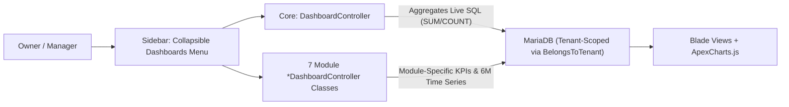

# Section 1: Dashboards & Executive Analytics

## 1. Why Your Business Needs This Section
Without live dashboards, a business owner flies blind — waiting until the end of the month to discover that cash collection is falling behind invoiced revenue, top-selling products are almost out of stock, or procurement spend spiked. This section puts **8 real-time decision cockpits** under one collapsible `Dashboards` menu at the top of the sidebar.

## 2. What It Helps You Do & Who Uses It
- **CEO / Business Owner (`Executive Overview`)**: Checks total orders, invoiced revenue vs. actual cash collected, procurement spend over the last 6 months, fulfillment rate, collection efficiency, and low-stock warnings in 30 seconds every morning.
- **Department Heads**: Each manager gets their own focused analytics hub (`Finance`, `Inventory`, `Sales`, `Procurement`, `HRM`, `POS`, `CRM`) showing only their KPIs, charts, and urgent action items.

### Real-World Example
You open `/admin/dashboard` at 9:00 AM. You see **Invoiced Revenue = `$120,000`** but **Cash Collected = `$72,000` (60% Collection Efficiency)**. You immediately click `Sales Analytics` -> `Invoices` -> filter `Overdue` -> follow up with late-paying clients before a cash crunch happens.

## 3. Every Dashboard Screen & Route

| Dashboard | URL | Controller | Key Business Metrics |
| :--- | :--- | :--- | :--- |
| **Executive Overview** | `/admin/dashboard` | `Modules\Core\Http\Controllers\DashboardController` | 6M Revenue vs Cash vs Spend, Order Pipeline Donut, Collection/Fulfillment/Stock Health Gauges, Top SKUs |
| **Finance Analytics** | `/admin/accounting/dashboard` | `Modules\Accounting\Http\Controllers\FinanceDashboardController` | Posted Ledger Volume, Cash Collected, Refunds, Account Composition |
| **Inventory Analytics** | `/admin/inventory/dashboard` | `Modules\Inventory\Http\Controllers\InventoryDashboardController` | Catalog SKUs, Units On Hand, Stock Cost Valuation, Low-Stock Alerts |
| **Sales Analytics** | `/admin/sales/dashboard` | `Modules\Sales\Http\Controllers\SalesDashboardController` | Orders, Invoiced Revenue, Unpaid AR, Overdue Invoices, Top Customers |
| **Procurement Analytics** | `/admin/procurement/dashboard` | `Modules\Procurement\Http\Controllers\ProcurementDashboardController` | Active Suppliers, Open POs, Received Spend, Unpaid Vendor Bills |
| **HRM Analytics** | `/admin/hrm/dashboard` | `Modules\Hrm\Http\Controllers\HrmDashboardController` | Active Workforce, Today's Attendance %, Monthly Base Payroll, Pending Leaves |
| **POS Analytics** | `/admin/pos/dashboard` | `Modules\Pos\Http\Controllers\PosDashboardController` | Today's Revenue, Total POS Revenue, Avg Ticket, Open Shifts, Payment Mix |
| **CRM Analytics** | `/admin/crm/dashboard` | `Modules\Crm\Http\Controllers\CrmDashboardController` | Total Leads, Conversion %, Open Pipeline Value, Won Revenue, Win Rate |

## 4. Architecture & Data Flow Diagram

## 5. How the Code Is Connected
- **Layout Shell**: `resources/views/admin/layouts/app.blade.php` loads ApexCharts, DataTables, SweetAlert2, theme persistence, and RTL/LTR styling.
- **Navigation**: `resources/views/admin/layouts/sidebar.blade.php` checks `$featureManager->isEnabled('<module>')` AND `@can('<permission>')` before showing any dashboard link.
- **No Auto-Expand Noise**: `public/admin/assets/js/app.js` keeps the `Dashboards` dropdown closed on page refresh until you explicitly click it.
- **Blade Views**: `resources/views/admin/dashboard.blade.php` + `resources/views/admin/{accounting,inventory,sales,procurement,hrm,pos,crm}/dashboard.blade.php`.
