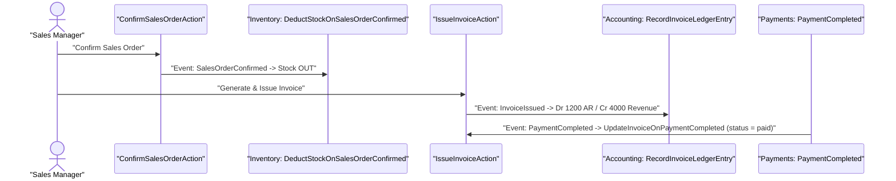

# Section 02: Sales & Billing (`modules/Sales/`)

## 1. Why Your Business Needs This Section
This section runs your **B2B Order-to-Cash** engine — selling on purchase orders, delivering from warehouses, issuing formal legal invoices, and tracking who still owes you money. Without it, sales reps promise stock you don't have, invoices get lost, and accounting never matches actual billings.

## 2. What It Helps With & Real-World Business Flow
**Real Example**: *Global Tech Ltd* orders 2 Enterprise Laptops at `$1,299.00` each + 10% tax (`$2,857.80` total):
1. **Customers (`/admin/customers`)**: Manage B2B client profiles (`code`, `name`, `email`, `phone`, `tax_number`, `credit_limit`, `billing_address`). *(Also created automatically when CRM converts a Lead!)*
2. **Sales Orders (`/admin/orders`)**: Create a Draft multi-item order selecting Customer, fulfilling Warehouse, quantities, and server-calculated prices/tax. Click **Confirm** -> `ConfirmSalesOrderAction` marks it `confirmed` and fires `SalesOrderConfirmed` -> **Inventory (`DeductStockOnSalesOrderConfirmed`) automatically deducts 2 units from the warehouse**.
3. **Invoices (`/admin/invoices`)**:
   - Filter by status tabs (`All`, `Draft`, `Issued`, `Paid`, `Overdue`, `Cancelled`).
   - Click **Generate from Order** to convert a Confirmed Sales Order into an Invoice in 1 click (or create standalone).
   - Click **Issue** -> `IssueInvoiceAction` fires `InvoiceIssued` -> **Accounting (`RecordInvoiceLedgerEntry`) automatically posts `Dr 1200 AR / Cr 4000 Sales Revenue`**.
   - Click **Print / PDF** for a clean client-ready invoice (`/admin/invoices/{id}/print`) or **Collect Payment** directly from an Issued/Overdue invoice.
   - When Payments completes collection (`PaymentCompleted`), **Sales (`UpdateInvoiceOnPaymentCompleted`)** locks the invoice row, increments `amount_paid`, and automatically flips status to `paid` once settled.

## 3. Order-to-Cash Sequence Diagram

## 4. Database & Code Connections

| Component | Exact Files | Purpose |
| :--- | :--- | :--- |
| Tables (`000022`–`000026`) | `customers`, `sales_orders`, `sales_order_items`, `invoices`, `invoice_items` | All prices, discounts, tax, totals, `amount_paid` in `bigint` cents |
| Provider | `modules/Sales/Providers/SalesServiceProvider.php` | Wires `PaymentCompleted -> UpdateInvoiceOnPaymentCompleted` |
| Events & Listener | `Events/SalesOrderConfirmed`, `Events/InvoiceIssued`, `Listeners/UpdateInvoiceOnPaymentCompleted` | Automates Inventory stock deduction, Accounting revenue posting, and Invoice settlement |
| Actions | `CreateCustomerAction`, `UpdateCustomerAction`, `CreateSalesOrderAction`, `ConfirmSalesOrderAction`, `CreateInvoiceAction`, `IssueInvoiceAction` | Server-side financial totals and state guards |
| Controllers | `SalesDashboardController`, `CustomerController`, `SalesOrderController`, `InvoiceController` | Sales KPIs, CRUD DataTables, 1-click SO->Invoice, PDF print |
| Blade UI | `resources/views/admin/sales/{dashboard,customers,invoices,invoice-print}.blade.php`, `resources/views/admin/orders/index.blade.php` | Status tabs, View/Print modals, multi-item builders |
| Security | `feature:sales` + `sales.customers.*`, `sales.orders.*`, `sales.invoices.*` | Enforced on web & API routes |
