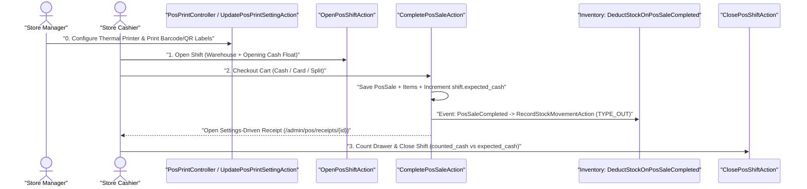

# Section 03: Point of Sale — POS (`modules/Pos/`)

## 1. Why Your Business Needs This Section
Walk-in retail counters move fast — a cashier cannot fill out a B2B Sales Order and separate Invoice for every shopper buying 3 items at the counter. At the same time, cash drawers are the #1 source of retail shrinkage if opening floats and end-of-day counts aren't tracked, and physical retail stores also need **shelf/product barcode & QR labels**, a **dedicated POS orders history**, and **thermal printer customization (58mm / 80mm / A4)**. POS solves speed, cash control, and retail hardware printing in one module.

## 2. What It Helps With & Real-World Business Flow
**Real Example**: Morning-to-closing retail workflow at your store counter:
1. **Configure Store Printer Once (`/admin/pos/print-settings`)**:
   - Store manager selects thermal paper width (`58mm`, `80mm`, or `A4`), sets Store Name, Address, Phone, Tax Number, Footer Message, and toggles (`Show Cashier`, `Show Customer`, `Show Tax Breakdown`, `Show Barcode on Receipt`, `Auto-Print Receipt`).
   - A live thermal receipt preview updates as you type.
2. **Print Product Barcode & QR Labels (`/admin/pos/barcodes` & `/admin/pos/qrcodes`)**:
   - Pick any product from Inventory, choose barcode format (`Code 128`, `EAN-13`, `UPC-A`, `Code 39`) or QR size, set copy quantity, paper size (`A4` or `Thermal`), labels per row, and toggle product name/price/SKU.
   - Click **Print Labels** to print a clean `@media print` label sheet for shelves and product packaging.
3. **Open Shift (`/admin/pos/terminal` or `/admin/pos/shifts`)**:
   - Cashier opens shift `SH-2026-01`, selects the store's fulfilling `Warehouse`, and logs the **Opening Cash Float** (`$200.00`). Only one open shift per cashier is permitted at a time.
4. **Ring Up Sales on POS Terminal (`/admin/pos/terminal`)**:
   - Search products by SKU/name or filter by Category and click product cards to add to the ticket.
   - Optionally select a named `Customer` (or leave as `Walk-in Customer`).
   - Adjust quantity, discount, tax %, choose `Cash`, `Card`, or `Split`, enter tendered cash, and see exact `Change Due`.
   - Click **Complete Sale & Print Receipt** -> `CompletePosSaleAction` computes all totals server-side inside `DB::transaction`, creates `PosSale` + `PosSaleItems`, increments `shift.expected_cash` for cash/split payments, and fires `PosSaleCompleted` -> **Inventory (`DeductStockOnPosSaleCompleted`) immediately deducts stock from that shift's warehouse**.
5. **Thermal Receipt (`/admin/pos/receipts/{id}`)**:
   - Automatically applies your tenant's `PosPrintSetting` (exact paper width `260px`/`360px`/`480px`, store header/tax #, optional cashier/customer/tax rows, scannable `JsBarcode` receipt barcode, custom footer, and optional auto-print on load).
6. **Review & Reprint POS Orders (`/admin/pos/orders`)**:
   - Dedicated counter order log showing today's order count, revenue, payment methods, customer, cashier, and one-click receipt reprint.
7. **Close & Reconcile Shift (`/admin/pos/shifts`)**:
   - At closing time, cashier counts physical cash in the drawer (`Counted Cash`) and closes the shift. Owner immediately compares `Expected Cash` vs `Counted Cash` on the Register Shifts table!

## 3. Shift, Checkout & Printing Sequence Diagram

## 4. Database & Code Connections

| Component | Exact Files | Purpose |
| :--- | :--- | :--- |
| Tables (`000039`–`000041`, `000049`) | `pos_shifts`, `pos_sales`, `pos_sale_items`, `pos_print_settings` | All floats, prices, tax, tendered, `change_due` in `bigint` cents; per-tenant printer & label settings |
| Models | `PosShift`, `PosSale` (with `shift`, `customer`, `cashier`, `items`), `PosSaleItem`, `PosPrintSetting` | Tenant-isolated ULID models with full audit trail |
| Provider | `modules/Pos/Providers/PosServiceProvider.php` | Registered in `bootstrap/providers.php`; loads `modules/Pos/routes/web.php` & migrations |
| Event & Listener | `Events/PosSaleCompleted` -> `modules/Inventory/Listeners/DeductStockOnPosSaleCompleted` | Auto-deducts sold counter items from `$sale->shift->warehouse_id` |
| Actions | `OpenPosShiftAction`, `ClosePosShiftAction`, `CompletePosSaleAction`, `UpdatePosPrintSettingAction` | Enforces open-shift requirement, server-side totals, drawer tracking, and tenant printer settings |
| Controllers | `PosDashboardController`, `PosTerminalController`, `PosShiftController`, `PosPrintController` | Daily sales analytics, terminal & receipt, shifts DataTables, POS orders, barcode/QR generators, print settings |
| Blade UI | `resources/views/admin/pos/{dashboard,terminal,receipt,shifts,orders,barcodes,qrcodes,print-settings}.blade.php` | ApexCharts analytics, live terminal, dynamic thermal receipt, scannable `JsBarcode` & `QRCode.js` sheets, live print settings preview |
| Security | `feature:pos` + `pos.terminal.view`, `pos.sales.create`, `pos.shifts.view`, `pos.shifts.manage` | Feature-gated & role-protected |
