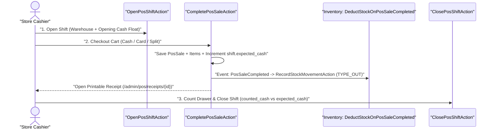

# Section 03: Point of Sale — POS (`modules/Pos/`)

## 1. Why Your Business Needs This Section
Walk-in retail counters move fast — a cashier cannot fill out a B2B Sales Order and separate Invoice for every shopper buying 3 items at the counter. At the same time, cash drawers are the #1 source of retail shrinkage if opening floats and end-of-day counts aren't tracked. POS solves both speed and cash control.

## 2. What It Helps With & Real-World Business Flow
**Real Example**: Morning retail shift at your store counter:
1. **Open Shift (`/admin/pos/terminal` or `/admin/pos/shifts`)**: Cashier opens shift `SH-2026-01`, selects the store's fulfilling `Warehouse`, and logs the **Opening Cash Float** (`$200.00`). Only one open shift per cashier is permitted at a time.
2. **Ring Up Sales on POS Terminal (`/admin/pos/terminal`)**:
   - Search products by SKU/name or filter by Category and click product cards to add to the ticket.
   - Optionally select a named `Customer` (or leave as `Walk-in Customer`).
   - Adjust quantity, discount, tax %, choose `Cash`, `Card`, or `Split`, enter tendered cash, and see exact `Change Due`.
   - Click **Complete Sale & Print Receipt** -> `CompletePosSaleAction` computes all totals server-side inside `DB::transaction`, creates `PosSale` + `PosSaleItems`, increments `shift.expected_cash` for cash/split payments, and fires `PosSaleCompleted` -> **Inventory (`DeductStockOnPosSaleCompleted`) immediately deducts stock from that shift's warehouse**.
3. **Thermal Receipt (`/admin/pos/receipts/{id}`)**: Opens a print-ready receipt showing tenant header, receipt #, cashier, shift, line items, tax, tendered amount, and change due.
4. **Close & Reconcile Shift (`/admin/pos/shifts`)**: At closing time, cashier counts physical cash in the drawer (`Counted Cash`) and closes the shift. Owner immediately compares `Expected Cash` vs `Counted Cash` on the Register Shifts table!

## 3. Shift & Checkout Sequence Diagram

## 4. Database & Code Connections

| Component | Exact Files | Purpose |
| :--- | :--- | :--- |
| Tables (`000039`–`000041`) | `pos_shifts`, `pos_sales`, `pos_sale_items` | All floats, prices, tax, tendered, `change_due` in `bigint` cents |
| Provider | `modules/Pos/Providers/PosServiceProvider.php` | Registered in `bootstrap/providers.php`; loads `modules/Pos/routes/web.php` & migrations |
| Event & Listener | `Events/PosSaleCompleted` -> `modules/Inventory/Listeners/DeductStockOnPosSaleCompleted` | Auto-deducts sold counter items from `$sale->shift->warehouse_id` |
| Actions | `OpenPosShiftAction`, `ClosePosShiftAction`, `CompletePosSaleAction` | Enforces open-shift requirement, server-side totals, drawer tracking |
| Controllers | `PosDashboardController`, `PosTerminalController`, `PosShiftController` | Daily sales/payment-mix analytics, interactive terminal, shifts & sales DataTables |
| Blade UI | `resources/views/admin/pos/{dashboard,terminal,receipt,shifts}.blade.php` | ApexCharts analytics, live product grid + cart, thermal receipt, reconciliation tables |
| Security | `feature:pos` + `pos.terminal.view`, `pos.sales.create`, `pos.shifts.view`, `pos.shifts.manage` | Feature-gated & role-protected |
