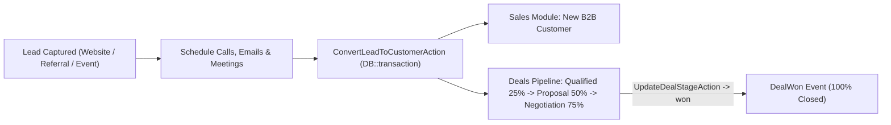

# Section 04: CRM — Customer Relationship Management (`modules/Crm/`)

## 1. Why Your Business Needs This Section
Sales Orders only track people who have **already decided to buy**. Most real revenue is won (or lost) *weeks earlier* during inquiries, demos, quotes, and follow-up calls. Without CRM:
- Hot website/referral inquiries sit forgotten in someone's inbox.
- When a salesperson leaves, all prospect history walks out the door with them.
- You have no idea how much revenue is likely to close next month (**Sales Pipeline Forecast**).

## 2. What It Helps With & Real-World Business Flow
**Real Example**: *Nordic Logistics Group* submits a website inquiry for an `$18,500.00` rollout:
1. **Leads (`/admin/crm/leads`)**: Sales rep logs Lead `LD-2026-001` with source `Website`, estimated value `$18,500.00`, and assigned owner.
2. **Activities (`/admin/crm/activities`)**: Rep schedules a follow-up `Phone Call` and `Meeting` with due dates so nothing is missed, then marks each activity `Completed` once done.
3. **1-Click Lead Conversion**: Once qualified, rep clicks **Convert** -> `ConvertLeadToCustomerAction` runs inside `DB::transaction`:
   - Automatically creates a real B2B `Customer` in `modules/Sales/`.
   - Automatically opens a `CrmDeal` opportunity (`Qualified`, 30% probability, `$18,500.00`).
   - Marks the Lead `converted` and dispatches `LeadConverted`.
4. **Deals Pipeline (`/admin/crm/deals`)**: Rep moves the Deal stage inline: `Qualified (25%)` -> `Proposal (50%)` -> `Negotiation (75%)` -> `Won (100%)` (or `Lost (0%)`). Moving to `Won` stamps `closed_at` and fires `DealWon`. Now Sales & Billing creates the Sales Order and Invoice for that exact Customer!

## 3. Business & Code Flow Diagram

## 4. Database & Code Connections

| Component | Exact Files | Purpose |
| :--- | :--- | :--- |
| Tables (`000042`–`000044`) | `crm_leads`, `crm_deals`, `crm_activities` | ULIDs, `estimated_value` & `value_amount` in `bigint` cents |
| Provider | `modules/Crm/Providers/CrmServiceProvider.php` | Registered in `bootstrap/providers.php`; loads `modules/Crm/routes/web.php` & migrations |
| Actions | `CreateLeadAction`, `UpdateLeadAction`, `ConvertLeadToCustomerAction`, `CreateDealAction`, `UpdateDealStageAction`, `CreateActivityAction`, `CompleteActivityAction` | Atomic Lead->Customer+Deal creation, stage probability sync, `LeadConverted` & `DealWon` events |
| Controllers | `CrmDashboardController`, `LeadController`, `DealController`, `ActivityController` | CRM Analytics, Server-Side DataTables with status/stage filters, AJAX convert/stage/complete |
| Blade UI | `resources/views/admin/crm/{dashboard,leads,deals,activities}.blade.php` | Pipeline Stage Bar Chart, Lead Source Donut, Leads/Deals/Activities screens |
| Security | `feature:crm` + `crm.leads.*`, `crm.deals.*`, `crm.activities.*` | Feature-flagged & role-protected |
