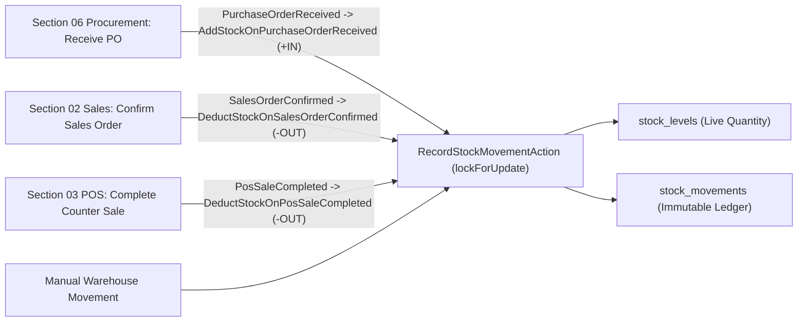

# Section 05: Inventory & Stock (`modules/Inventory/`)

## 1. Why Your Business Needs This Section
Inventory is **cash sitting on shelves**. If your stock counts are inaccurate:
- You sell items you don't actually have (angry customers & cancellations).
- You run out of bestsellers because nobody noticed stock dropped below reorder level.
- Employees could silently edit stock numbers to hide theft or damaged goods.

## 2. What It Helps With & Real-World Business Flow
- **Categories (`/admin/categories`)**: Organize products into hierarchical groups (`Electronics -> Laptops`).
- **Warehouses (`/admin/warehouses`)**: Track separate physical locations (`Main Warehouse`, `Retail Backroom`, `Regional Hub`) with one default warehouse.
- **Products (`/admin/products`)**: Master catalog with unique `SKU`, `Cost Price` (cents), `Selling Price` (cents), `Unit`, `Reorder Level`, and `track_inventory` toggle (so services don't require physical stock).
- **Immutable Stock Ledger (`stock_movements` + `stock_levels`)**:
  - Every stock change (`Stock IN +`, `Stock OUT -`, `Adjustment +/-`) flows through **one single gatekeeper**: `RecordStockMovementAction`.
  - It locks the `(warehouse_id, product_id)` row with `lockForUpdate()` inside `DB::transaction`, blocks negative stock (`Insufficient stock`), updates `stock_levels.quantity_on_hand`, and inserts a permanent `StockMovement` row that **throws `RuntimeException` if anyone ever tries to edit or delete it**.

## 3. Cross-Module Automation Diagram

## 4. Database & Code Connections

| Component | Exact Files | Purpose |
| :--- | :--- | :--- |
| Tables (`000017`–`000021`) | `categories`, `warehouses`, `products`, `stock_levels`, `stock_movements` | `cost_price`, `selling_price`, `unit_cost` in `bigint` cents |
| Provider | `modules/Inventory/Providers/InventoryServiceProvider.php` | Wires all 3 cross-module stock listeners (`SalesOrderConfirmed`, `PurchaseOrderReceived`, `PosSaleCompleted`) |
| Key Action | `modules/Inventory/Actions/RecordStockMovementAction.php` | Concurrency-safe `DB::transaction` + `lockForUpdate()` + negative stock guard |
| Listeners | `AddStockOnPurchaseOrderReceived`, `DeductStockOnSalesOrderConfirmed`, `DeductStockOnPosSaleCompleted` | Automatic stock IN/OUT across Procurement, B2B Sales, and Retail POS |
| Controllers | `InventoryDashboardController`, `ProductController`, `CategoryController`, `WarehouseController`, `StockMovementController` | Inventory valuation analytics, CRUD DataTables, manual movements |
| Blade UI | `resources/views/admin/inventory/{dashboard,warehouses}.blade.php`, `resources/views/admin/{products,categories}/index.blade.php` | Stock alerts, warehouse distribution chart, catalog tables |
| Security | `feature:inventory` + `inventory.products.*`, `inventory.categories.*`, `inventory.warehouses.*`, `inventory.stock-movements.*` | Enforced on web & API routes |
