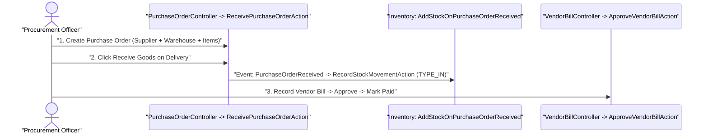

# Section 06: Procurement & Accounts Payable (`modules/Procurement/`)

## 1. Why Your Business Needs This Section
Sales brings money in, while **Procurement (Procure-to-Pay)** controls how your company buys stock and pays suppliers. Without structured Procurement:
- Staff buy from unapproved vendors at inconsistent prices.
- Warehouse workers have to manually type received items into Inventory a second time (causing typos).
- You miss vendor bill due dates or accidentally pay the same supplier bill twice.

## 2. What It Helps With & Real-World Business Flow
**Real Example**: Stock of laptops runs low; you order 20 more units at `$900.00` each (`$18,000.00`):
1. **Suppliers (`/admin/procurement/suppliers`)**: Maintain approved vendor directory with payment terms (`Net 30`), tax number, email, and address.
2. **Purchase Orders (`/admin/procurement/orders`)**: Create PO `PO-2026-001` selecting the Supplier, destination `Warehouse`, and line items with unit cost.
3. **Receive Goods (1-Click Stock Automation)**: When the truck arrives, warehouse/procurement clicks **Receive** -> `ReceivePurchaseOrderAction` marks the PO `received` and fires `PurchaseOrderReceived` -> **Inventory (`AddStockOnPurchaseOrderReceived`) automatically adds +20 units (`TYPE_IN`) to the selected warehouse**.
4. **Vendor Bills (`/admin/procurement/bills`)**: When the supplier sends their invoice, Finance logs a Vendor Bill linked to the Supplier/PO -> Manager clicks **Approve** -> Finance clicks **Mark Paid** when bank transfer clears.

## 3. Business & Code Flow Diagram

## 4. Database & Code Connections

| Component | Exact Files | Purpose |
| :--- | :--- | :--- |
| Tables (`000030`–`000033`) | `suppliers`, `purchase_orders`, `purchase_order_items`, `vendor_bills` | All costs & totals in `bigint` cents |
| Provider | `modules/Procurement/Providers/ProcurementServiceProvider.php` | Registered in `bootstrap/providers.php`; loads `modules/Procurement/routes/web.php` & migrations |
| Event & Listener | `Events/PurchaseOrderReceived` -> `modules/Inventory/Listeners/AddStockOnPurchaseOrderReceived` | Eliminates double entry between purchasing and warehouse stock |
| Actions | `CreateSupplierAction`, `UpdateSupplierAction`, `CreatePurchaseOrderAction`, `ReceivePurchaseOrderAction`, `CreateVendorBillAction`, `ApproveVendorBillAction` | Server-side PO total math, status guards, approval workflow |
| Controllers | `ProcurementDashboardController`, `SupplierController`, `PurchaseOrderController`, `VendorBillController` | Spend analytics + Server-Side DataTables CRUD |
| Blade UI | `resources/views/admin/procurement/{dashboard,suppliers,purchase-orders,vendor-bills}.blade.php` | Spend vs Bills charts, PO builder, AP bill tracking |
| Security | `feature:procurement` + `procurement.suppliers.*`, `procurement.orders.*`, `procurement.bills.*` | Role-gated & audited |
