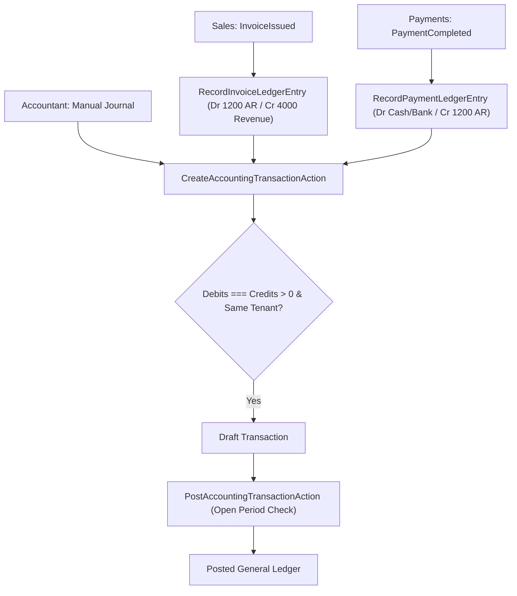

# Section 07: Finance & General Ledger (`modules/Accounting/`)

## 1. Why Your Business Needs This Section
Revenue on a sales screen is **not** the same as profit or bank balance. Every serious company needs a **Double-Entry General Ledger** where every dollar has both a source and a destination (`Total Debits === Total Credits`), fiscal periods can be locked after month-end, and routine sales/payment entries post automatically without manual bookkeeping errors.

## 2. What It Helps With & Real-World Business Flow
1. **Chart of Accounts (`/admin/accounting/accounts`)**:
   Your company's financial map grouped into 5 classic types:
   - **Assets (`1xxx`)**: Cash/Bank (`1010`), Accounts Receivable (`1200`) — what you own.
   - **Liabilities (`2xxx`)**: Accounts Payable — what you owe.
   - **Equity (`3xxx`)**: Owner capital & retained earnings.
   - **Revenue (`4xxx`)**: Sales Revenue (`4000`) — money earned.
   - **Expenses (`5xxx`+)**: Costs of running the business.
2. **Ledger Transactions (`/admin/accounting/transactions`)**:
   - **Manual Journals**: Accountants record rent, bank fees, or adjustments in a Draft transaction with 2+ lines. `CreateAccountingTransactionAction` **refuses to save** unless `Total Debits === Total Credits > 0` and every `account_id` belongs to the active tenant.
   - **Posting**: Clicking **Post** (`PostAccountingTransactionAction`) verifies the target `FinancialPeriod` is still open and permanently posts the entry.
   - **Automatic Entries**:
     - When Sales issues an invoice (`InvoiceIssued`), `RecordInvoiceLedgerEntry` automatically creates & posts: **Debit `1200` Accounts Receivable / Credit `4000` Sales Revenue**.
     - When Payments completes a payment (`PaymentCompleted`), `RecordPaymentLedgerEntry` automatically creates & posts: **Debit `1010` (or method's linked account) Cash/Bank / Credit `1200` Accounts Receivable**.

## 3. Double-Entry & Auto-Posting Diagram

## 4. Database & Code Connections

| Component | Exact Files | Purpose |
| :--- | :--- | :--- |
| Tables (`000011`–`000016`) | `currencies`, `financial_years`, `financial_periods`, `accounts`, `accounting_transactions`, `accounting_transaction_lines` | `debit` & `credit` stored in `bigint` cents |
| Provider | `modules/Accounting/Providers/AccountingServiceProvider.php` | Wires `InvoiceIssued -> RecordInvoiceLedgerEntry` and `PaymentCompleted -> RecordPaymentLedgerEntry` |
| Actions | `CreateAccountAction`, `UpdateAccountAction`, `CreateAccountingTransactionAction`, `PostAccountingTransactionAction` | Enforces double-entry balance, tenant account ownership, and open fiscal period rules |
| Controllers | `FinanceDashboardController`, `AccountController`, `AccountingTransactionController` | Finance KPIs, CoA CRUD, Journal DataTables + Post endpoint |
| Blade UI | `resources/views/admin/accounting/{dashboard,accounts,transactions}.blade.php` | Treasury charts, CoA table, multi-line journal builder |
| Security | `feature:accounting` + `accounting.accounts.*`, `accounting.transactions.*` | Role-gated & immutable audit trail |
