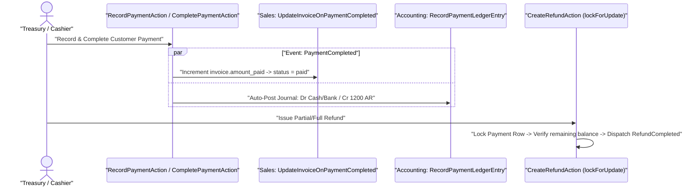

# Section 08: Payments & Treasury (`modules/Payments/`)

## 1. Why Your Business Needs This Section
Sending an invoice doesn't pay salaries — **collecting cash** does. This section manages every payment channel your company accepts, records partial or full settlements against customer invoices, automatically updates both Sales and Accounting, and enforces **concurrency-safe refunds** so nobody can ever refund more money than the customer originally paid.

## 2. What It Helps With & Real-World Business Flow
**Real Example**: Customer pays `$2,857.80` via Bank Transfer for Invoice `INV-2026-00001`:
1. **Payment Methods (`/admin/payments`)**: Configure channels (`Cash`, `Bank Transfer`, `Card`, `Cheque`, `Wallet`), each optionally linked to a specific `Account` (`account_id`) in Finance so bank deposits debit the exact bank ledger account.
2. **Record & Complete Payment (`/admin/payments`)**:
   - Finance records a payment linked to the Invoice and marks it `completed`.
   - `PaymentCompleted` event fires and triggers **two simultaneous automations**:
     1. **Sales (`UpdateInvoiceOnPaymentCompleted`)**: Locks the Invoice row, adds the payment to `amount_paid`, and marks the Invoice `paid` when balance reaches `$0.00`.
     2. **Accounting (`RecordPaymentLedgerEntry`)**: Debits Cash/Bank (`account_id` or `1010`) and credits Accounts Receivable (`1200`).
3. **Concurrency-Safe Refunds (`/admin/payments/refunds`)**:
   - If a customer returns goods, staff issue a partial or full refund via `CreateRefundAction`.
   - Inside `DB::transaction`, `CreateRefundAction` locks the `Payment` row (`lockForUpdate()`), sums prior completed refunds, and **throws an error if `alreadyRefunded + refundAmount > payment.amount`** — eliminating double-refund bugs even under simultaneous clicks.

## 3. Payment & Refund Automation Diagram

## 4. Database & Code Connections

| Component | Exact Files | Purpose |
| :--- | :--- | :--- |
| Tables (`000027`–`000029`) | `payment_methods`, `payments`, `refunds` | Amounts stored in `bigint` cents |
| Provider | `modules/Payments/Providers/PaymentsServiceProvider.php` | Loads web & API routes + migrations |
| Events | `Events/PaymentCompleted`, `Events/RefundCompleted` | Consumed by `Sales` and `Accounting` |
| Actions | `CreatePaymentMethodAction`, `UpdatePaymentMethodAction`, `RecordPaymentAction`, `CompletePaymentAction`, `CreateRefundAction` | Row-locked refund balance guard + unique numbering |
| Controllers | `PaymentMethodController`, `PaymentController`, `RefundController` | DataTables & AJAX endpoints |
| Blade UI | `resources/views/admin/payments/{index,refunds}.blade.php` | Channel cards, Payments table, Refunds workflow |
| Security | `feature:payments` + `payments.methods.*`, `payments.transactions.*`, `payments.refunds.*` | Role-gated & audited |
