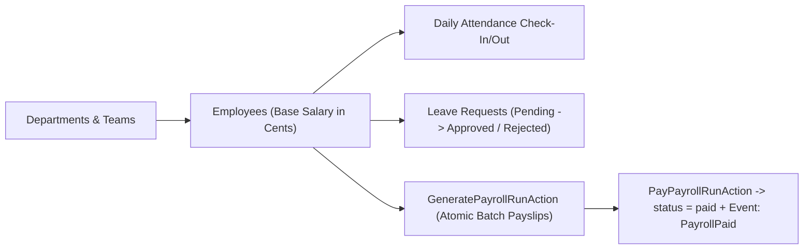

# Section 09: Organization, HR & Payroll (`modules/Hrm/` & `modules/Users/`)

## 1. Why Your Business Needs This Section
Your team is your biggest operating cost and competitive advantage. This section combines **Company Structure** (`Departments`, `Teams`, `Staff Directory` in `modules/Users/`) with **Full Hire-to-Pay HRM** (`Employees`, `Attendance`, `Leave Requests`, `Payroll Runs` in `modules/Hrm/`) so you can track headcount, attendance, time off, and monthly salaries accurately in one place.

## 2. What It Helps With & Real-World Business Flow
1. **Departments (`/admin/organization/departments`) & Teams (`/admin/organization/teams`)**:
   Define business units (Finance, Sales, Warehouse, Retail) and nested Teams with multi-team member assignments (`team_members`).
2. **Staff Directory (`/admin/organization/staff`)**:
   Create login accounts for employees and assign their RBAC roles (`Super Admin`, `Accountant`, `Sales Manager`, etc.).
3. **Employees (`/admin/hrm/employees`)**:
   Official HR records (`employee_code`, `department_id`, `job_title`, `employment_type`, `hire_date`, `base_salary` in cents, `status`).
4. **Attendance (`/admin/hrm/attendance`)**:
   Daily check-in/out logs (`present`, `late`, `absent`, `half_day`) feeding the live **Today's Attendance %** gauge on HRM Analytics.
5. **Leave Requests (`/admin/hrm/leaves`)**:
   Annual, sick, emergency, or unpaid leave requests with 1-click manager **Approve / Reject** workflow (`ReviewLeaveRequestAction`).
6. **Payroll Runs (`/admin/hrm/payroll`)**:
   - **What is a Payroll Run?** One monthly batch payout for the whole company (e.g., `PAYROLL-202611`).
   - Clicking **Generate Payroll Run** (`GeneratePayrollRunAction`) loops through **every active employee** inside one `DB::transaction`, calculates `base_salary + allowances - deductions = net_pay` (using basis points, e.g., `1000 bps = 10%`), creates an individual `PayrollItem` payslip per employee, and sums `total_gross`, `total_deductions`, and `total_net`.
   - Clicking **View Payslips** inspects every employee's breakdown; clicking **Pay** (`PayPayrollRunAction`) locks the run as `paid`, stamps `paid_at`, and dispatches `PayrollPaid`.

## 3. Hire-to-Pay Workflow Diagram

## 4. Database & Code Connections

| Component | Exact Files | Purpose |
| :--- | :--- | :--- |
| Tables | `departments`, `teams`, `team_members` (`000008`); `employees`, `attendances`, `leave_requests`, `payroll_runs`, `payroll_items` (`000034`–`000038`) | Complete org hierarchy + HR/payroll ledger in cents |
| Providers | `modules/Hrm/Providers/HrmServiceProvider.php`, `modules/Users/Providers/UsersServiceProvider.php` | Register routes, migrations, and Gate RBAC |
| Actions | `CreateEmployeeAction`, `UpdateEmployeeAction`, `RecordAttendanceAction`, `CreateLeaveRequestAction`, `ReviewLeaveRequestAction`, `GeneratePayrollRunAction`, `PayPayrollRunAction`, plus `CreateDepartmentAction`, `CreateTeamAction`, `CreateStaffUserAction` | Atomic payroll calculation & org CRUD |
| Controllers | `HrmDashboardController`, `EmployeeController`, `AttendanceController`, `LeaveRequestController`, `PayrollController`, `OrganizationController` | HRM KPIs, DataTables, payslip viewer, org management |
| Blade UI | `resources/views/admin/hrm/{dashboard,employees,attendance,leaves,payroll}.blade.php`, `resources/views/admin/organization/{departments,teams,staff}.blade.php` | Charts, staff tables, payroll modal & payslips popup |
| Security | `feature:hrm` + `hrm.*` permissions + `users.departments.*`, `users.teams.*`, `users.roles.assign` | Strict HR/salary data protection |
