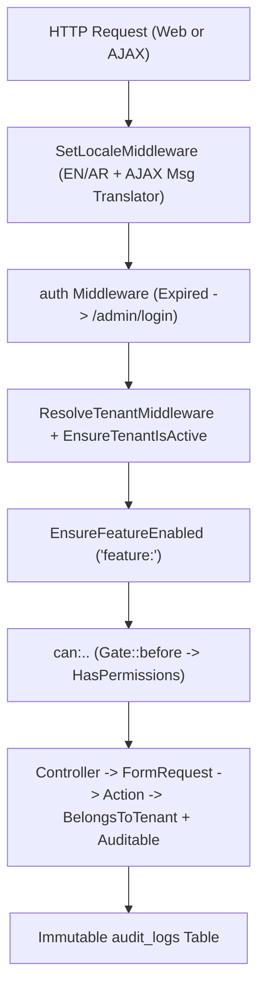

# Section 10: System, Security, Feature Flags & Multi-Language (`modules/Core/` & `modules/Users/`)

## 1. Why Your Business Needs This Section
This is the **control room & security vault** of your ERP. It ensures:
- **Zero data leaks** between multiple companies/branches (**Multi-Tenancy**).
- **Zero unauthorized actions** — a cashier cannot approve payroll or delete ledger entries (**RBAC Roles & Permissions**).
- **Zero mystery edits** — every create/update/delete is permanently logged (**Immutable Audit Trail**).
- **Modular flexibility** — turn entire departments ON or OFF per tenant in 1 click (**Feature Flags**).
- **Bilingual operations** — every team member can switch instantly between **English (LTR)** and **Arabic (RTL)** without breaking URLs or data.

## 2. Every Control Room Screen & Capability
1. **Module Feature Flags (`/admin/features`)**:
   Toggle any of the 8 modules (`accounting`, `inventory`, `sales`, `payments`, `procurement`, `hrm`, `pos`, `crm`) ON or OFF per tenant (`FeatureManager`). Disabling a flag hides it from the sidebar AND blocks all routes (`EnsureFeatureEnabled` -> `403`).
2. **Roles & RBAC (`/admin/roles`) & Permissions Matrix (`/admin/permissions`)**:
   Define tenant-scoped roles (`Super Admin`, `Accountant`, `Sales Manager`, custom roles) using dotted permissions (`module.resource.action`). `UsersServiceProvider` bridges Laravel's `Gate::before` to `HasPermissions`, supporting **per-user explicit denies & grants** that override role defaults.
3. **Compliance Audit Trail (`/admin/audit-logs`)**:
   Immutable log (`AuditLog` throws `RuntimeException` on update/delete) powered by the `Auditable` trait, recording actor, IP address, model, event (`created`/`updated`/`deleted`), and before/after JSON snapshots.
4. **Authentication, Brute-Force Lockout, TOTP MFA & Sessions**:
   5 failed logins -> 15-minute lockout (`LoginHistory`); last 5 passwords blocked (`PasswordHistory`); RFC 6238 Authenticator app 2FA (`TotpService`); active device session revocation (`UserActiveSession`); expired sessions redirect cleanly to `/admin/login`.
5. **Bilingual EN / العربية (RTL) Engine**:
   - `SetLocaleMiddleware` reads `session('locale')` (or tenant default), sets `app()->setLocale()`, AND automatically translates AJAX JSON `'message'` responses into Arabic when `ar` is active.
   - `app.blade.php` flips `<html dir="rtl">`, loads Bootstrap 5.0.2 RTL + **Cairo** font + `public/admin/assets/css/rtl.css`, and injects global Arabic DataTables defaults.
   - `lang/ar.json` + `lang/ar/validation.php` translate every menu, KPI, table header, modal, dropdown `<option>`, button, SweetAlert2 prompt, and validation error.

## 3. Security & Request Pipeline Diagram

## 4. Database & Code Connections

| Component | Exact Files | Purpose |
| :--- | :--- | :--- |
| Tables (`000001`–`000010`) | `tenants`, `users`, `user_mfa_secrets`, `login_histories`, `password_histories`, `user_active_sessions`, `roles`, `permissions`, `role_permissions`, `user_roles`, `user_permissions`, `audit_logs`, `tenant_features` | Full SaaS tenancy, security & governance foundation |
| Middleware (`bootstrap/app.php`) | `SetLocaleMiddleware`, `ResolveTenantMiddleware` (`tenant`), `EnsureTenantIsActive` (`tenant.active`), `EnsureFeatureEnabled` (`feature`) | Global request security & localization pipeline |
| Core Services & Traits | `TenantContext`, `FeatureManager`, `BelongsToTenant`, `HasPermissions`, `Auditable`, `TotpService` | Automatic tenant scoping, feature caching, RBAC & audit hooks |
| Controllers | `FeatureController`, `LocaleController`, `RoleController`, `AuditLogController`, `AdminAuthController`, `AuthController`, `MfaController`, `SessionController`, `ProfileController` | Admin security & platform endpoints |
| Localization Assets | `lang/ar.json`, `lang/ar/validation.php`, `public/admin/assets/css/rtl.css`, `resources/views/admin/layouts/{app,header,sidebar,footer}.blade.php` | Full EN/AR RTL styling, fonts, DataTables & translations |
