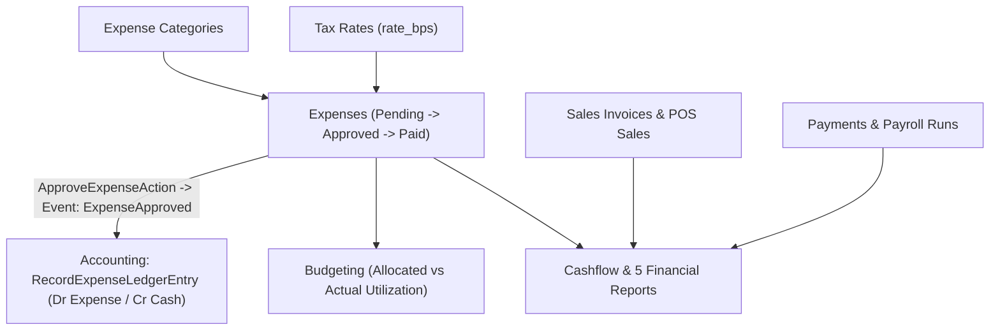

# Section 11: Finance Operations — Expenses, Cashflow, Budgets, Taxes & Reports (`modules/Finance/`)

## 1. Why Your Business Needs This Section
While **Accounting (`modules/Accounting/`)** is your strict double-entry General Ledger (Chart of Accounts & Journal Entries), day-to-day business owners and finance managers also need **operational finance tools**:
- Tracking every operational bill & receipt (**Expenses & Categories**) without manually typing debit/credit journals.
- Seeing real money coming in vs. going out (**Cashflow**).
- Setting spending limits per department/category and getting warned before overspending (**Budgeting**).
- Managing regional VAT/GST/Sales Tax rates centrally (**Taxes**).
- Pulling instant executive **Financial Reports** (Profit & Loss, Income vs. Expense, Tax Summary, Expense Summary, Income Summary) with one click.

Keeping `modules/Finance/` separate from `modules/Accounting/` gives you clean modular architecture: Accounting owns the immutable General Ledger, while Finance owns operational spending, planning, and executive reporting (and automatically posts approved expenses to Accounting!).

## 2. What It Helps With & Real-World Business Flow
1. **Expense Categories (`/admin/finance/expense-categories`)**:
   Organize operational spending (e.g., *Office Rent*, *Utilities*, *Marketing*, *Software Subscriptions*, *Travel*), optionally linked to a default General Ledger expense account (`5xxx`).
2. **Expenses (`/admin/finance/expenses`)**:
   - Staff or finance logs an expense with category, amount, tax rate, vendor/payee, payment method, date, and reference.
   - Status lifecycle: `pending` -> `approved` -> `paid` (or `rejected`).
   - Clicking **Approve** (`ApproveExpenseAction`) marks the expense approved and dispatches `ExpenseApproved` -> `modules/Accounting/Listeners/RecordExpenseLedgerEntry` automatically creates & posts the double-entry journal (**Debit Expense Account / Credit Cash or Accounts Payable**).
3. **Cashflow (`/admin/finance/cashflow`)**:
   Unified money-in vs. money-out timeline combining **B2B Customer Payments**, **POS Retail Sales**, **Paid Operational Expenses**, **Vendor Bills**, and **Payroll Runs** with net cashflow KPIs and an interactive ApexCharts trend chart.
4. **Budgeting (`/admin/finance/budgets`)**:
   - Create monthly/quarterly/annual spending caps per `ExpenseCategory` (`allocated_amount` in cents).
   - Live utilization bars compare **Allocated Budget** vs. **Actual Spent** (auto-calculated from approved/paid expenses in that period) and flag **Over Budget** categories in red.
5. **Taxes (`/admin/finance/taxes`)**:
   Manage reusable tax rates stored in **basis points (`rate_bps`)** — e.g., `1500` = `15.00%` — scoped to `sales`, `purchase`, or `both`, with active/default toggles.
6. **Financial Reports (`/admin/finance/reports/*`)**:
   Five date-filtered, print-ready executive reports:
   - **Expense Summary** (`/admin/finance/reports/expense-summary`) — Breakdown of operational & payroll expenses by category.
   - **Income Summary** (`/admin/finance/reports/income-summary`) — B2B invoiced revenue vs. POS retail revenue.
   - **Profit & Loss (P&L)** (`/admin/finance/reports/profit-loss`) — Total Income, Operating + Payroll Expenses, Gross Profit, Net Profit, and Net Margin %.
   - **Income vs. Expense** (`/admin/finance/reports/income-vs-expense`) — Month-by-month comparison chart & table.
   - **Tax Summary** (`/admin/finance/reports/tax-summary`) — Output Tax (collected on Sales/POS) vs. Input Tax (paid on Expenses/Purchases) = Net Tax Payable.

## 3. Finance-to-Ledger & Reporting Flow

## 4. Database & Code Connections

| Component | Exact Files | Purpose |
| :--- | :--- | :--- |
| Tables (`000045`–`000048`) | `expense_categories`, `tax_rates`, `expenses`, `budgets` | All monetary values in `bigint` cents; tax rates in `rate_bps` |
| Provider | `modules/Finance/Providers/FinanceServiceProvider.php` | Registered in `bootstrap/providers.php`; loads `modules/Finance/routes/web.php` & migrations |
| Event & Listener | `Modules\Finance\Events\ExpenseApproved` -> `Modules\Accounting\Listeners\RecordExpenseLedgerEntry` | Auto-posts double-entry ledger journal when an expense is approved |
| Actions | `CreateExpenseCategoryAction`, `CreateExpenseAction`, `ApproveExpenseAction`, `CreateBudgetAction`, `CreateTaxRateAction` | Tenant-scoped writes with integer-cent validation and full audit logging |
| Controllers | `ExpenseController`, `ExpenseCategoryController`, `CashflowController`, `BudgetController`, `TaxRateController`, `FinanceReportController` | CRUD DataTables, cashflow aggregation, budget utilization, and 5 executive reports |
| Blade UI | `resources/views/admin/finance/{expenses,expense-categories,cashflow,budgets,taxes}.blade.php` + `resources/views/admin/finance/reports/{expense-summary,income-summary,profit-loss,income-vs-expense,tax-summary}.blade.php` | Full Rukada dark/light & RTL Arabic UI with ApexCharts & `@media print` reports |
| Security | `feature:finance` + `finance.expenses.*`, `finance.budgets.*`, `finance.taxes.*`, `finance.reports.view` | Feature-flagged per tenant & RBAC permission-gated |
