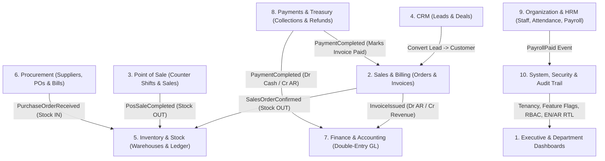

# ERP Business Owner's Complete Section-by-Section Encyclopedia (`docs/sections/`)

Welcome to your **complete business & code playbook** for the ERP. Unlike technical build logs, this folder is organized **1-to-1 with the exact sections in your ERP sidebar** so you can understand every part of the company like an owner **and** trace every click down to the exact PHP classes and database tables.

---

## How All 10 Sections Work Together as One Company

---

## Complete Section Directory

| # | Sidebar Section | Business Purpose | Guide File |
| :--- | :--- | :--- | :--- |
| 1 | **Dashboards** | Live KPIs & ApexCharts across the entire company | [01-dashboards-analytics.md](01-dashboards-analytics.md) |
| 2 | **Sales & Billing** | B2B Customers, Sales Orders & Full Invoicing Lifecycle | [02-sales-and-billing.md](02-sales-and-billing.md) |
| 3 | **Point of Sale (POS)** | Fast Retail Counter, Cash Drawer Shifts & Thermal Receipts | [03-point-of-sale.md](03-point-of-sale.md) |
| 4 | **CRM** | Capturing Leads, Tracking Deals Pipeline & Follow-up Calls | [04-crm.md](04-crm.md) |
| 5 | **Inventory & Stock** | Product Catalog, Warehouses & Tamper-Proof Stock Ledger | [05-inventory-and-stock.md](05-inventory-and-stock.md) |
| 6 | **Procurement & AP** | Suppliers, Purchase Orders, Goods Receipt & Vendor Bills | [06-procurement-and-ap.md](06-procurement-and-ap.md) |
| 7 | **Finance & Ledger** | Chart of Accounts, Fiscal Periods & Double-Entry Accounting | [07-finance-and-ledger.md](07-finance-and-ledger.md) |
| 8 | **Payments & Treasury** | Collecting Payments & Concurrency-Safe Refunds | [08-payments-and-treasury.md](08-payments-and-treasury.md) |
| 9 | **Organization & HR** | Employees, Attendance, Leaves, Payroll Runs, Depts & Teams | [09-organization-and-hrm.md](09-organization-and-hrm.md) |
| 10 | **System & Security** | Multi-Tenancy, Feature Flags, RBAC, Audit Log & EN/AR RTL | [10-system-security-and-i18n.md](10-system-security-and-i18n.md) |

---

## Golden Rules That Apply to Every Section
1. **Money is always stored as integer cents (`bigint`)**: `$1,250.50` is saved as `125050` so floating-point math can never lose a penny.
2. **Primary keys are ULIDs (`HasUlids`)**: Globally unique, time-sortable, and impossible for competitors to guess.
3. **Every table is tenant-isolated (`BelongsToTenant`)**: Multiple companies can run on one server with zero data leakage.
4. **Every write is audited (`Auditable`)**: Creating, editing, or deleting business records writes a permanent before/after snapshot into `audit_logs`.
5. **Bilingual EN / العربية (RTL)**: Every screen, dropdown, modal, DataTable, validation message, and AJAX toast supports instant English ↔ Arabic switching.
